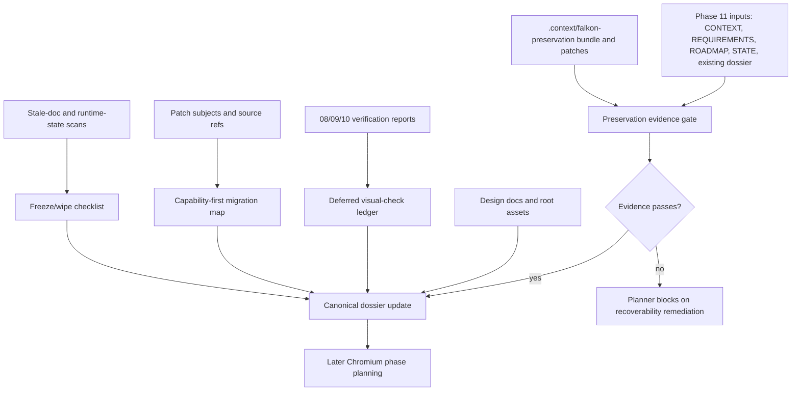

# Phase 11: Preservation Contract and Falkon Freeze - Research

**Researched:** 2026-06-23 [VERIFIED: environment_context current_date]
**Domain:** Git source preservation, migration-contract documentation, license-boundary documentation, and deferred visual-verification triage [VERIFIED: .planning/ROADMAP.md Phase 11]
**Confidence:** HIGH for local preservation state and required phase outputs; MEDIUM for future Chromium owner mapping because later phases have planned scopes but no Chromium implementation yet [VERIFIED: local commands 2026-06-23; VERIFIED: .planning/ROADMAP.md]

<user_constraints>
## User Constraints (from CONTEXT.md)

Source for this entire block: `.planning/phases/11-preservation-contract-and-falkon-freeze/11-CONTEXT.md` [VERIFIED: file read 2026-06-23]

### Locked Decisions
## Implementation Decisions

### Preservation Artifact Contract
- **D-01:** Treat `.planning/preservation/FALKON-TO-CHROMIUM-PRESERVATION.md` as the canonical preservation dossier. Phase 11 should update, normalize, and complete it rather than create a parallel document.
- **D-02:** Verify recoverability with evidence: restore or inspect `.context/falkon-preservation/falkon-prometheus-v1.bundle`, confirm preserved HEAD `b0521c9d37e7545c680b78dfcc24f777a984091c`, and confirm the patch series contains the expected 81 patches.
- **D-03:** Do not recreate a long-lived active `falkon/` working tree. If a restore clone is needed, use a temporary or clearly named reference-only location under `.context/` and remove it or mark it read-only/reference-only after verification.
- **D-04:** Record that the active `falkon/` checkout has already been removed and reconcile any stale docs that still describe it as active.

### Migration Map Shape
- **D-05:** Build the migration map by capability and requirement first, with source/patch references only where they clarify behavior, assets, tests, or legal boundaries. Avoid a line-by-line Falkon implementation inventory unless needed for a specific high-risk surface.
- **D-06:** Every mapped item should answer: v1 behavior to preserve, Falkon reference source or patch reference, Chromium owner/future phase, parity test or validation evidence, and license/attribution note.
- **D-07:** Preserve contracts, not implementation. Patch subjects and file paths can guide planning, but downstream agents must reimplement on Chromium-native primitives.

### License Boundary
- **D-08:** Keep a strict default: no GPL Falkon C++ implementation, Qt widget classes, QSS, packaging scripts, or metadata should be copied into Chromium without explicit license review.
- **D-09:** Product-owned/root assets and planning design artifacts can be carried forward when provenance and license notes are clear. Falkon-derived bundled assets must be reintroduced only through a license-reviewed asset pipeline.
- **D-10:** Font Awesome, Poppins, Space Mono, PM/Prometheus, and FSB assets must retain their attribution/license requirements when ported.

### Deferred Visual Verification
- **D-11:** The 26 human-needed v1 checks from Phases 08, 09, and 10 should be tagged in Phase 11 as Chromium-equivalent checks unless the underlying surface no longer exists.
- **D-12:** Retire a visual check only with a written rationale that names the removed Falkon-only surface and the later Chromium phase that supersedes or intentionally drops it.
- **D-13:** Carry forward checks for the side panel/control panel, icon/font/theme rendering, offline asset behavior, and start page into the relevant Chromium phases instead of treating v1 static verification as enough.

### Freeze/Wipe Checklist
- **D-14:** The source wipe checklist should distinguish "already removed", "must stay", "reference-only", and "future Chromium-owned" items.
- **D-15:** `.planning/`, `.planning/design/`, `.planning/preservation/`, `.context/falkon-preservation/`, root `assets/`, and archived milestone docs must remain available.
- **D-16:** Phase 11 should note stale state from prior handoff: `.planning/STATE.md` still refers to a detached build session, while current local evidence shows no active `screen` session and `.context/chromium-build-screen.log` says the build finished successfully.

### the agent's Discretion
- Exact manifest/checklist format, temporary restore-check directory name, and script names are at the agent's discretion.
- The planner may choose whether the bundle/patch checks are implemented as shell, Node, or documented commands, as long as the evidence is reproducible and does not depend on an active Falkon tree.

### Claude's Discretion
- Exact manifest/checklist format, temporary restore-check directory name, and script names are at the agent's discretion.
- The planner may choose whether the bundle/patch checks are implemented as shell, Node, or documented commands, as long as the evidence is reproducible and does not depend on an active Falkon tree.

### Deferred Ideas (OUT OF SCOPE)
## Deferred Ideas

- Launching and validating the unmodified Chromium app belongs to Phase 12.
- Public notarization and updater work remain out of scope for v2 local validation until later release phases.
- Full Chromium feature implementation belongs to Phases 13-24; Phase 11 only preserves and maps contracts.
</user_constraints>

<phase_requirements>
## Phase Requirements

| ID | Description | Research Support |
|----|-------------|------------------|
| PRES-01 | Developer can recover the full Falkon-based Prometheus v1 source reference from a local preservation bundle after the active `falkon/` tree is removed. [VERIFIED: .planning/REQUIREMENTS.md] | Use `git bundle verify`, `git ls-remote`, and one temporary `git clone` under `.context/falkon-preservation/`; local verification restored HEAD `b0521c9d37e7545c680b78dfcc24f777a984091c`. [VERIFIED: local commands 2026-06-23; CITED: https://git-scm.com/docs/git-bundle] |
| PRES-02 | Project has a written inventory of v1 product decisions, design tokens, UI surfaces, asset paths, tool contracts, tests, validation scripts, and deferred verification items before source removal. [VERIFIED: .planning/REQUIREMENTS.md] | Complete the canonical dossier with capability inventory, asset/license inventory, source/patch references, and the 26 deferred human checks from Phases 08-10. [VERIFIED: .planning/preservation/FALKON-TO-CHROMIUM-PRESERVATION.md; VERIFIED: 08/09/10-VERIFICATION.md] |
| PRES-03 | Project has an explicit migration map from each v1 Falkon/Qt implementation surface to a Chromium-native owner or a deliberately deferred/out-of-scope item. [VERIFIED: .planning/REQUIREMENTS.md] | Use a capability-first map with columns for behavior contract, Falkon reference, Chromium phase owner, parity evidence, and license note. [VERIFIED: 11-CONTEXT.md D-05/D-06] |
| PRES-04 | Project distinguishes behavior/design contracts from GPL-derived Falkon implementation code so Chromium work does not copy GPL source without license review. [VERIFIED: .planning/REQUIREMENTS.md] | Preserve behavior/design contracts and mark Falkon C++/Qt/QSS/package assets as reference-only unless license-reviewed. [VERIFIED: temp restore COPYING GPLv3 text; CITED: https://www.gnu.org/licenses/gpl-3.0.en.html] |
| PRES-05 | Developer can remove the active `falkon/` checkout from the workspace without losing source history, patches, assets, or planning context. [VERIFIED: .planning/REQUIREMENTS.md] | Active `falkon/` directory is absent, `.context/falkon-preservation/` contains the bundle plus 81 patches, and `.context/` is ignored by the root gitdir exclude. [VERIFIED: `test -d falkon` exit 1; VERIFIED: patch count command; VERIFIED: `git check-ignore -v`] |
| PRES-06 | Root project documentation no longer presents Falkon/QtWebEngine as the production architecture after the Chromium baseline is established. [VERIFIED: .planning/REQUIREMENTS.md] | Phase 11 should update or explicitly tag stale docs such as `README.md` and `.planning/STATE.md` that still describe Qt/Falkon or an active detached Chromium build. [VERIFIED: `rg` stale-reference scan; VERIFIED: build log/status/screen commands] |
| PRES-07 | v1 deferred human-visual verification items are either re-run against Chromium equivalents or explicitly retired with rationale because the Falkon UI surface no longer exists. [VERIFIED: .planning/REQUIREMENTS.md] | Tag all 26 checks as Chromium-equivalent or retired with rationale, phase owner, and future validation command/manual check. [VERIFIED: 08-VERIFICATION.md has 10; VERIFIED: 09-VERIFICATION.md has 8; VERIFIED: 10-VERIFICATION.md has 8] |
</phase_requirements>

## Summary

Phase 11 should be planned as a preservation-contract and evidence phase, not as Chromium feature work. [VERIFIED: 11-CONTEXT.md Phase Boundary] The local source archive is already strong: `git bundle verify` reports the bundle is valid, the bundle lists `HEAD` and `refs/heads/master` at `b0521c9d37e7545c680b78dfcc24f777a984091c`, and the patch directory contains 81 `.patch` files. [VERIFIED: local commands 2026-06-23] A temporary restore clone under `.context/falkon-preservation/` restored that HEAD and was removed after verification, so the planner can make recoverability evidence a scripted gate without recreating an active `falkon/` tree. [VERIFIED: temporary restore command 2026-06-23]

The canonical output should be an expanded `.planning/preservation/FALKON-TO-CHROMIUM-PRESERVATION.md` plus, if useful, a small executable verification script that checks the dossier invariants. [VERIFIED: 11-CONTEXT.md D-01; VERIFIED: 11-CONTEXT.md discretion] The dossier needs four missing or under-specified pieces: a reproducible preservation evidence block, a capability-first migration map, a wipe/freeze checklist with item statuses, and a deferred-visual-check ledger for the 26 human-needed checks. [VERIFIED: 11-CONTEXT.md D-02/D-06/D-14/D-11]

The main risks are stale docs and license boundary drift. [VERIFIED: `rg` stale-reference scan; VERIFIED: temp restore COPYING GPLv3 text] `README.md` still describes Prometheus as built on Qt/QtWebEngine and lists `falkon/` build commands, while `.planning/STATE.md` and `.planning/chromium/CHROMIUM-CHECKOUT.md` still say the first Chromium build is running even though the status file is `0`, there is no `screen` session, and the log says the build finished successfully. [VERIFIED: local `rg`, `screen -ls`, status file, and log tail commands 2026-06-23]

**Primary recommendation:** Plan Phase 11 around one dossier update, one preservation verification gate, one stale-doc/wipe checklist pass, and one 26-row deferred visual-check mapping ledger. [VERIFIED: synthesis from 11-CONTEXT.md, REQUIREMENTS.md, and local artifact checks]

## Project Constraints

- No root `AGENTS.md` file exists in this workspace. [VERIFIED: `test -f AGENTS.md` command 2026-06-23]
- No root `CLAUDE.md` file exists in this workspace. [VERIFIED: `test -f CLAUDE.md` command 2026-06-23]
- No project-local `.claude/skills/` or `.agents/skills/` `SKILL.md` files were found. [VERIFIED: `find .claude/skills .agents/skills -maxdepth 2 -name SKILL.md` command 2026-06-23]
- `.planning/config.json` has `commit_docs: true`, `workflow.nyquist_validation: true`, `brave_search: false`, `exa_search: false`, and `firecrawl: false`. [VERIFIED: .planning/config.json read 2026-06-23]
- `.planning/config.json` already has an unrelated dirty diff adding `_auto_chain_active: false` and removing the trailing newline; Phase 11 research should not stage that file unless a later task intentionally owns it. [VERIFIED: `git diff -- .planning/config.json` 2026-06-23]

## Architectural Responsibility Map

| Capability | Primary Tier | Secondary Tier | Rationale |
|------------|-------------|----------------|-----------|
| Preservation bundle recoverability | Git archive / workspace filesystem | Planning docs | `git bundle` is the recoverable source archive, and the dossier records exact verification evidence. [VERIFIED: `git bundle verify`; CITED: https://git-scm.com/docs/git-bundle] |
| Patch-series availability | Git patch archive / workspace filesystem | Planning docs | `format-patch` output is the source-change series consumed as reference evidence, not active implementation. [VERIFIED: 81 patch files; CITED: https://git-scm.com/docs/git-format-patch] |
| Migration contract | Planning / documentation | Future Chromium code owners | Phase 11 maps capabilities to later Chromium phases without implementing them. [VERIFIED: 11-CONTEXT.md D-05/D-07; VERIFIED: ROADMAP Phases 13-24] |
| License boundary | Planning / legal documentation | Future Chromium implementation review | The phase distinguishes behavior/design contracts from GPL-derived implementation before Chromium work starts. [VERIFIED: 11-CONTEXT.md D-08/D-09; CITED: https://www.gnu.org/licenses/gpl-3.0.en.html] |
| Source wipe checklist | Planning / repository hygiene | Workspace filesystem | The checklist declares what is already removed, what must stay, what is reference-only, and what becomes Chromium-owned. [VERIFIED: 11-CONTEXT.md D-14/D-15] |
| Deferred visual checks | Planning / validation ledger | Future Chromium UI/WebUI/Views phases | The 26 v1 human-needed checks need phase owners and future Chromium validation status. [VERIFIED: 08/09/10-VERIFICATION.md; VERIFIED: 11-CONTEXT.md D-11/D-13] |
| Stale handoff cleanup | Planning docs | Local build state | Phase 11 must reconcile docs with the current evidence that the Chromium build finished and no build screen remains. [VERIFIED: 11-CONTEXT.md D-16; VERIFIED: `screen -ls`, status file, log tail] |

## Standard Stack

### Core

| Library / Tool | Version | Purpose | Why Standard |
|----------------|---------|---------|--------------|
| Git | 2.50.1 Apple Git-155 | Bundle verification, restore clone, refs inspection, patch-series validation. [VERIFIED: `git --version`] | Git bundles are official Git archives that can be verified, listed, cloned from, fetched from, and used for full repository backups. [CITED: https://git-scm.com/docs/git-bundle] |
| POSIX shell / Bash | GNU bash 3.2.57 on macOS | Reproducible local verification script for bundle, patch count, stale refs, and no active `falkon/`. [VERIFIED: `bash --version`] | Shell checks are enough because the phase validates files, git refs, and docs rather than app runtime behavior. [VERIFIED: phase scope in 11-CONTEXT.md] |
| ripgrep | 15.1.0 | Fast stale-doc and required-section checks. [VERIFIED: `rg --version`] | `rg` is already available and suitable for scanning planning docs and patch text. [VERIFIED: command availability 2026-06-23] |

### Supporting

| Library / Tool | Version | Purpose | When to Use |
|----------------|---------|---------|-------------|
| Node.js | v24.14.1 | Optional structured validation script if shell becomes too brittle for parsing 26 check rows. [VERIFIED: `node --version`] | Use only if the planner wants JSON/Markdown parsing stronger than shell/rg. [VERIFIED: 11-CONTEXT.md discretion] |
| npm | 11.11.0 | Not required for Phase 11, but available if a future validator needs a package. [VERIFIED: `npm --version`] | Avoid new packages for this phase unless a clear parser requirement appears. [VERIFIED: no package.json/test infra found by `rg --files`] |
| GNU screen | 4.00.03 | Handoff-state audit only. [VERIFIED: `screen --version`] | Use `screen -ls` to prove the stale Chromium build session is no longer active. [VERIFIED: `screen -ls` output] |

### Alternatives Considered

| Instead of | Could Use | Tradeoff |
|------------|-----------|----------|
| Git bundle | `.tar.gz` or `.zip` of restored source | Do not use archive copies as the primary recovery artifact because Git bundle preserves refs/objects and has official verify/clone workflows. [CITED: https://git-scm.com/docs/git-bundle] |
| Capability-first migration map | Line-by-line Falkon inventory | Avoid the line inventory because the locked decision is to preserve contracts, not implementation, and line inventories invite copy-forward of GPL implementation details. [VERIFIED: 11-CONTEXT.md D-05/D-07/D-08] |
| Temporary restore clone | Long-lived `falkon/` working tree | Do not recreate active `falkon/`; if clone evidence is needed, create it under `.context/` and delete it or label it reference-only. [VERIFIED: 11-CONTEXT.md D-03] |

**Installation:**

```bash
# No npm package installation is required for Phase 11. [VERIFIED: no package.json/test infra found; VERIFIED: phase scope is docs/git preservation]
```

**Version verification:**

```bash
git --version
node --version
npm --version
rg --version | sed -n '1p'
bash --version | sed -n '1p'
screen --version
```

The above commands returned Git 2.50.1, Node v24.14.1, npm 11.11.0, ripgrep 15.1.0, GNU bash 3.2.57, and screen 4.00.03. [VERIFIED: local commands 2026-06-23]

## Architecture Patterns

### System Architecture Diagram



The diagram shows Phase 11 data flow from local evidence and planning inputs into one canonical dossier that later Chromium phases consume. [VERIFIED: 11-CONTEXT.md D-01/D-05/D-14; VERIFIED: ROADMAP Phases 13-24]

### Recommended Project Structure

```text
.planning/
├── preservation/
│   └── FALKON-TO-CHROMIUM-PRESERVATION.md  # canonical dossier, migration map, wipe checklist, visual-check ledger [VERIFIED: 11-CONTEXT.md D-01]
├── chromium/
│   └── CHROMIUM-CHECKOUT.md                # update stale build handoff state, do not move Phase 12 scope here [VERIFIED: file read; VERIFIED: local build state]
└── phases/11-preservation-contract-and-falkon-freeze/
    └── 11-RESEARCH.md                      # this research artifact [VERIFIED: output request]

.context/
└── falkon-preservation/
    ├── falkon-prometheus-v1.bundle          # local recoverable Git bundle [VERIFIED: git bundle verify]
    └── patches/                             # 81 patch files [VERIFIED: patch count command]
```

### Pattern 1: Evidence-First Preservation Gate

**What:** Make preservation acceptance depend on commands that prove the bundle is valid, list expected refs, restore to a temporary clone, and count patches. [VERIFIED: local commands 2026-06-23; CITED: https://git-scm.com/docs/git-bundle]

**When to use:** Use this at the beginning and end of Phase 11, and before any source-wipe checklist is marked complete. [VERIFIED: PRES-01/PRES-05 in REQUIREMENTS.md]

**Example:**

```bash
git bundle verify .context/falkon-preservation/falkon-prometheus-v1.bundle
git ls-remote .context/falkon-preservation/falkon-prometheus-v1.bundle HEAD refs/heads/master refs/remotes/origin/master
find .context/falkon-preservation/patches -maxdepth 1 -name '*.patch' | wc -l

tmpdir=$(mktemp -d .context/falkon-preservation/restore-check-XXXXXX)
git clone .context/falkon-preservation/falkon-prometheus-v1.bundle "$tmpdir/repo"
git -C "$tmpdir/repo" rev-parse HEAD
rm -rf "$tmpdir"
```

Source: Git bundle documentation supports `verify`, `list-heads`/refs inspection, and cloning from bundles. [CITED: https://git-scm.com/docs/git-bundle]

### Pattern 2: Capability-First Migration Rows

**What:** Each row should map one capability to a behavior contract, reference source or patch, future Chromium owner, parity evidence, and license note. [VERIFIED: 11-CONTEXT.md D-05/D-06]

**When to use:** Use for all v1 surfaces: compact chrome/tabs, side panel, control panel, start page, fonts/icons/themes/assets, MCP bridge, agent router, runtime/vault/memory/logs, supervision, parity/release gates, and legal notices. [VERIFIED: preservation dossier behavior inventory; VERIFIED: REQUIREMENTS traceability]

**Example:**

```markdown
| Capability | v1 Behavior Contract | Falkon Reference | Chromium Owner | Parity Evidence | License Note |
|------------|----------------------|------------------|----------------|-----------------|--------------|
| Start page Ask FSB handoff | Prompt seeds FSB Agent composer without auto-submit | `start.html`, `prometheusstartbridge.*`, patches 0066-0071 | Phase 16 WebUI | Future WebUI/browser test plus manual UAT | Contract portable; QWebChannel/C++ implementation reference-only |
```

Source: Phase 10 verification confirms the non-auto-submit behavior and source refs; Chromium WebUI docs identify browser-backed WebUI as the target primitive. [VERIFIED: 10-VERIFICATION.md; CITED: https://chromium.googlesource.com/chromium/src/+/main/docs/webui/webui_explainer.md]

### Pattern 3: Deferred Visual Check Ledger

**What:** Convert each human-needed v1 check into a row with original phase, original expected result, Chromium-equivalent phase owner, status (`carry_forward` or `retired`), and retirement rationale if applicable. [VERIFIED: 11-CONTEXT.md D-11/D-12]

**When to use:** Use for the 10 Phase 08 checks, 8 Phase 09 checks, and 8 Phase 10 checks. [VERIFIED: 08/09/10-VERIFICATION.md]

**Example:**

```markdown
| Original | Check | Chromium Phase | Status | Rationale / Future Evidence |
|----------|-------|----------------|--------|-----------------------------|
| 09-05 | Toolbar icons are bundled FA vector glyphs | Phase 14 | carry_forward | Re-run against Chromium resource-packed icon paths; preserve FA attribution comments |
```

Source: Phase 09 verification lists this exact check and Phase 14 owns asset/design porting. [VERIFIED: 09-VERIFICATION.md; VERIFIED: ROADMAP Phase 14]

### Anti-Patterns to Avoid

- **Recreating `falkon/` as active source:** This contradicts the freeze decision and can make later planners treat Falkon as implementation input instead of reference evidence. [VERIFIED: 11-CONTEXT.md D-03/D-07]
- **Treating static v1 verification as visual completion:** The prior reports explicitly mark 26 checks `human_needed`; Phase 11 must carry them forward or retire them with rationale. [VERIFIED: 08/09/10-VERIFICATION.md; VERIFIED: 11-CONTEXT.md D-11/D-12]
- **Copying Qt/Falkon implementation text into Chromium tasks:** The restored Falkon repo carries GPLv3 text, and the locked decision requires behavior contracts rather than source copying. [VERIFIED: temp restore COPYING; VERIFIED: 11-CONTEXT.md D-08]
- **Leaving root docs as if `falkon/` is still active:** `README.md` currently lists Qt/QtWebEngine and `falkon/` build commands, which conflicts with Phase 11 retirement once Chromium baseline is established. [VERIFIED: local `rg` stale-reference scan]

## Don't Hand-Roll

| Problem | Don't Build | Use Instead | Why |
|---------|-------------|-------------|-----|
| Repository preservation | Custom tar/zip/archive protocol | `git bundle create --all`, `git bundle verify`, `git clone <bundle>` | Git bundles are official, refs-aware, verifiable, and cloneable. [CITED: https://git-scm.com/docs/git-bundle] |
| Patch-series reference | Manual commit copy ledger | Existing `format-patch` output under `.context/falkon-preservation/patches/` | Patch files already encode commit order and subjects for 81 preserved changes. [VERIFIED: patch list/count; CITED: https://git-scm.com/docs/git-format-patch] |
| Legal/license decision engine | Agent-authored legal interpretation | Strict reference-only default plus explicit human license review for any GPL-derived source copy | Phase decisions require no GPL implementation copy without review. [VERIFIED: 11-CONTEXT.md D-08; CITED: https://www.gnu.org/licenses/gpl-3.0.en.html] |
| Visual check closure | Static grep-only "visual done" status | Carry-forward ledger to future Chromium UAT/visual tests | All 26 open checks require a running UI or package context. [VERIFIED: 08/09/10-VERIFICATION.md] |
| Migration map generation | Automated line-by-line Falkon dump | Human-readable capability rows with source/patch refs | Locked decision requires capability and requirement mapping first. [VERIFIED: 11-CONTEXT.md D-05] |

**Key insight:** Phase 11 preserves provenance and contracts; it should not create replacement implementation or an exhaustive source inventory that tempts copy-forward of GPL Falkon code. [VERIFIED: 11-CONTEXT.md D-05/D-07/D-08]

## Runtime State Inventory

| Category | Items Found | Action Required |
|----------|-------------|------------------|
| Stored data | `.context/falkon-preservation/falkon-prometheus-v1.bundle` is valid and cloneable; `.context/falkon-preservation/patches/` has 81 patches; active `falkon/` directory is absent. [VERIFIED: `git bundle verify`; VERIFIED: temporary clone; VERIFIED: patch count; VERIFIED: `test -d falkon` exit 1] | Preserve `.context/falkon-preservation/`; add evidence commands/results to dossier; no source data migration required. [VERIFIED: 11-CONTEXT.md D-02/D-15] |
| Live service config | No detached `screen` session is active; `.context/chromium-build-screen.status` contains `0`; `.context/chromium-build-screen.log` says the build finished successfully. [VERIFIED: `screen -ls`; status/log reads 2026-06-23] | Update `.planning/STATE.md` and `.planning/chromium/CHROMIUM-CHECKOUT.md` stale handoff wording or mark it superseded. [VERIFIED: 11-CONTEXT.md D-16] |
| OS-registered state | `launchctl list` found no Falkon/Prometheus/Chromium entries; `screen -ls` found no sockets. [VERIFIED: local commands 2026-06-23] | No OS re-registration task for Phase 11. [VERIFIED: local command results] |
| Secrets/env vars | No `.env`, `.env.*`, `*secret*`, `*secrets*`, or `*sops*` files were found within max depth 3 of the workspace root. [VERIFIED: `find` command 2026-06-23] | No secret/env rename task for Phase 11; later Chromium phases must still avoid moving provider/vault secrets through MCP or renderer paths. [VERIFIED: PROJECT.md constraints; VERIFIED: preservation dossier non-negotiables] |
| Build artifacts | `.context/chromium/src/out`, `.context/chromium/src/build`, and `.context/fsb-reference/mcp/build` exist under ignored `.context/`; no active root `falkon/build` exists because `falkon/` is absent. [VERIFIED: `find` command; VERIFIED: `test -d falkon`] | Do not commit `.context/`; source wipe checklist should list `.context/chromium` as Phase 12 local build state and `.context/falkon-preservation` as must-stay preservation state. [VERIFIED: `git check-ignore -v`; VERIFIED: 11-CONTEXT.md D-15] |

## Common Pitfalls

### Pitfall 1: Bundle Verified But Restore Not Proved

**What goes wrong:** A plan runs `git bundle verify` but never proves the bundle can restore to the expected HEAD. [VERIFIED: risk derived from PRES-01 wording and Git bundle docs]

**Why it happens:** `verify` validates bundle integrity and prerequisites, while a restore clone proves the user-facing recovery workflow. [CITED: https://git-scm.com/docs/git-bundle]

**How to avoid:** Include a temporary clone check and `rev-parse HEAD == b0521c9d37e7545c680b78dfcc24f777a984091c`. [VERIFIED: successful temporary restore 2026-06-23]

**Warning signs:** The dossier only contains `git bundle verify` output and no restored HEAD evidence. [VERIFIED: current dossier lacks explicit restore evidence section]

### Pitfall 2: Dossier Becomes A Parallel Planning Document

**What goes wrong:** The planner creates a new preservation document and leaves `.planning/preservation/FALKON-TO-CHROMIUM-PRESERVATION.md` stale. [VERIFIED: current dossier exists; VERIFIED: 11-CONTEXT.md D-01]

**Why it happens:** Source wipe checklist and visual-check ledger are tempting to split into separate files. [ASSUMED]

**How to avoid:** Put primary map, checklist, and visual ledger in the canonical dossier; a helper script may exist, but the dossier remains the source of truth. [VERIFIED: 11-CONTEXT.md D-01]

**Warning signs:** Later phases need to read more than one preservation document to know what to preserve. [VERIFIED: downstream-consumer requirement in prompt]

### Pitfall 3: GPL Boundary Is Described Too Softly

**What goes wrong:** Chromium plans use Falkon file paths as implementation recipes and copy C++/Qt/QSS code. [VERIFIED: 11-CONTEXT.md D-07/D-08]

**Why it happens:** Patch series are useful technical references, but they are GPL-derived source history. [VERIFIED: temp restore COPYING; VERIFIED: patch files include GPL headers]

**How to avoid:** Every migration row must include a license/attribution note and say whether the artifact is contract-only, product-owned, third-party-licensed, or license-review-required. [VERIFIED: 11-CONTEXT.md D-06/D-08/D-09/D-10]

**Warning signs:** A row says "port `compacttabstrip.cpp`" without "reimplement on Chromium Views" or a license note. [VERIFIED: preservation dossier current Chromium target wording]

### Pitfall 4: Retiring Visual Checks Without A Named Replacement

**What goes wrong:** Human-needed v1 checks disappear because the Falkon UI no longer runs. [VERIFIED: 08/09/10-VERIFICATION.md; VERIFIED: 11-CONTEXT.md D-11]

**Why it happens:** Static verification reports passed automated checks and can be mistaken for full visual approval. [VERIFIED: 08/09/10-VERIFICATION.md statuses are `human_needed`]

**How to avoid:** Require `carry_forward` or `retired` status, Chromium phase owner, and rationale on every one of the 26 rows. [VERIFIED: 11-CONTEXT.md D-12/D-13]

**Warning signs:** A visual check row lacks Phase 14/15/16/23/24 ownership or a retirement reason. [VERIFIED: ROADMAP phase responsibilities]

### Pitfall 5: Stale Handoff State Misleads Phase 12

**What goes wrong:** Planners assume the first Chromium build is still running and skip launch/build status reconciliation. [VERIFIED: .planning/STATE.md and CHROMIUM-CHECKOUT.md stale wording]

**Why it happens:** `.planning/STATE.md` records the old detached screen state, but local evidence now says the build finished successfully. [VERIFIED: status/log/screen commands 2026-06-23]

**How to avoid:** Phase 11 should explicitly annotate the stale state and update handoff docs where the old state is false. [VERIFIED: 11-CONTEXT.md D-16]

**Warning signs:** Docs still mention active `prometheus-chromium-build` as running after `screen -ls` reports no sockets. [VERIFIED: local command results]

## Code Examples

Verified patterns from official/local sources. [VERIFIED: commands run locally; CITED: Git docs]

### Preservation Verification Script Skeleton

```bash
#!/usr/bin/env bash
set -euo pipefail

bundle=".context/falkon-preservation/falkon-prometheus-v1.bundle"
patch_dir=".context/falkon-preservation/patches"
expected_head="b0521c9d37e7545c680b78dfcc24f777a984091c"

git bundle verify "$bundle"
head_ref="$(git ls-remote "$bundle" HEAD | awk '{print $1}')"
test "$head_ref" = "$expected_head"

patch_count="$(find "$patch_dir" -maxdepth 1 -name '*.patch' | wc -l | tr -d ' ')"
test "$patch_count" = "81"

tmpdir="$(mktemp -d .context/falkon-preservation/restore-check-XXXXXX)"
git clone "$bundle" "$tmpdir/repo"
restored_head="$(git -C "$tmpdir/repo" rev-parse HEAD)"
rm -rf "$tmpdir"
test "$restored_head" = "$expected_head"
```

Source: `git bundle verify` and cloning from a bundle are official Git workflows. [CITED: https://git-scm.com/docs/git-bundle]

### Deferred Visual Check Row Shape

```markdown
| ID | Original Phase | Original Check | Chromium Owner | Status | Rationale / Future Evidence |
|----|----------------|----------------|----------------|--------|-----------------------------|
| VIS-09-05 | 09 | Toolbar icons are bundled FA vector glyphs | Phase 14 Asset and Design System Port | carry_forward | Re-run after Chromium resource packaging; preserve FA attribution comments |
```

Source: Phase 09 verification defines the icon check, and Phase 14 owns Chromium asset/design porting. [VERIFIED: 09-VERIFICATION.md; VERIFIED: ROADMAP Phase 14]

### Stale Doc Audit Command

```bash
rg -n 'falkon/|QtWebEngine|detached.*screen|prometheus-chromium-build|chromium-build-screen|build is running' README.md .planning
screen -ls || true
test -f .context/chromium-build-screen.status && cat .context/chromium-build-screen.status
test -f .context/chromium-build-screen.log && tail -40 .context/chromium-build-screen.log
```

Source: local audit found stale README/STATE/CHROMIUM-CHECKOUT references and current build state evidence. [VERIFIED: local commands 2026-06-23]

## State of the Art

| Old Approach | Current Approach | When Changed | Impact |
|--------------|------------------|--------------|--------|
| Treat Falkon/QtWebEngine as the production architecture | Treat Falkon as preserved v1 reference and rebuild on Chromium-native primitives | v2.0 pivot started 2026-06-17 [VERIFIED: PROJECT.md; VERIFIED: MILESTONES.md] | Phase 11 should freeze and map contracts, not continue Falkon development. [VERIFIED: 11-CONTEXT.md Phase Boundary] |
| Use active `falkon/` working tree for implementation context | Use `.context/falkon-preservation/` bundle and patches as reference-only evidence | v2.0 Phase 11/12 handoff [VERIFIED: CHROMIUM-CHECKOUT.md; VERIFIED: local `test -d falkon`] | Plans must not require an active Falkon checkout. [VERIFIED: 11-CONTEXT.md D-03] |
| Use Qt/QWebChannel/QSS/Falkon plugin APIs as implementation primitives | Use Chromium WebUI, browser-process services, Views, WebContents/RenderFrameHost, resource packs, and extension policy in later phases | v2.0 roadmap [VERIFIED: PROJECT.md; VERIFIED: ROADMAP Phases 13-24; CITED: Chromium WebUI docs] | Migration rows need future Chromium owners rather than copied source paths. [VERIFIED: 11-CONTEXT.md D-06/D-07] |
| Static v1 verification reports close visual quality | Deferred human-needed checks become Chromium-equivalent UAT or explicit retirements | v1.0 close carried into v2.0 [VERIFIED: STATE.md Deferred Items] | Phase 11 must preserve 26 checks as future validation obligations. [VERIFIED: 08/09/10-VERIFICATION.md] |

**Deprecated/outdated:**

- Root README architecture and build commands that present `falkon/` as active production source are outdated for v2.0 preservation/migration. [VERIFIED: `rg` stale-reference scan; VERIFIED: PROJECT.md Current State]
- Handoff text saying the first Chromium build is running is outdated because local status/log/screen evidence says it finished and no screen socket exists. [VERIFIED: `.context/chromium-build-screen.status`; VERIFIED: log tail; VERIFIED: `screen -ls`]
- Direct Falkon namespace/class/library rename is obsolete as a direct task because the implementation is being replaced and de-Falkon validation moves to Phase 23. [VERIFIED: STATE.md Deferred Items]

## Assumptions Log

| # | Claim | Section | Risk if Wrong |
|---|-------|---------|---------------|
| A1 | Source wipe checklist and visual check ledger are tempting to split into separate files. [ASSUMED] | Common Pitfalls | Low; locked decision still requires the canonical dossier to remain source of truth. |

## Open Questions

1. **How far should Phase 11 update root `README.md` versus only tag stale sections for Phase 13?** [VERIFIED: PRES-06 assigned to Phase 11; VERIFIED: ROADMAP Phase 13 also owns README architecture language]
   - What we know: `README.md` currently contains active Qt/QtWebEngine and `falkon/` build instructions. [VERIFIED: `rg` stale-reference scan]
   - What's unclear: The exact division between Phase 11 preservation cleanup and Phase 13 product identity/legal baseline is not explicitly locked. [VERIFIED: 11-CONTEXT.md; VERIFIED: ROADMAP Phase 13]
   - Recommendation: Phase 11 should at minimum update false active-source/build claims and record remaining product-doc updates as Phase 13-owned. [VERIFIED: synthesis from PRES-06 and D-04]

2. **Who performs explicit license review if a later phase wants a Falkon-derived asset or source hunk?** [VERIFIED: 11-CONTEXT.md D-08/D-09]
   - What we know: The default is no GPL Falkon implementation copy into Chromium without review. [VERIFIED: 11-CONTEXT.md D-08]
   - What's unclear: The project does not name a legal reviewer or approval artifact. [VERIFIED: reviewed provided phase/project docs]
   - Recommendation: Phase 11 should add an approval placeholder such as `license_review_required` in migration rows rather than attempting legal approval. [VERIFIED: synthesis from D-08/D-09]

3. **Should the preservation verification gate be shell or Node?** [VERIFIED: 11-CONTEXT.md discretion]
   - What we know: Shell, Node, and required CLI tools are available locally. [VERIFIED: environment availability commands]
   - What's unclear: The planner may prefer shell for simplicity or Node for Markdown row validation. [VERIFIED: 11-CONTEXT.md discretion]
   - Recommendation: Use shell for bundle/patch/stale-state checks and only add Node if the visual-check ledger needs structured Markdown parsing. [VERIFIED: local tool availability; VERIFIED: phase scope]

## Environment Availability

| Dependency | Required By | Available | Version | Fallback |
|------------|-------------|-----------|---------|----------|
| Git | Bundle/patch verification | yes [VERIFIED: `command -v git`] | 2.50.1 Apple Git-155 [VERIFIED: `git --version`] | none needed |
| Bash / POSIX shell | Verification script | yes [VERIFIED: `command -v bash`] | GNU bash 3.2.57 [VERIFIED: `bash --version`] | POSIX `sh` for simple checks |
| ripgrep | Stale-doc and section checks | yes [VERIFIED: `command -v rg`] | 15.1.0 [VERIFIED: `rg --version`] | `grep -R`, slower |
| Node.js | Optional structured parser | yes [VERIFIED: `command -v node`] | v24.14.1 [VERIFIED: `node --version`] | shell/awk |
| npm | Optional package manager | yes [VERIFIED: `command -v npm`] | 11.11.0 [VERIFIED: `npm --version`] | avoid packages |
| GNU screen | Build handoff audit | yes [VERIFIED: `command -v screen`] | 4.00.03 [VERIFIED: `screen --version`] | status/log files |

**Missing dependencies with no fallback:** None found for Phase 11 preservation work. [VERIFIED: environment commands 2026-06-23]

**Missing dependencies with fallback:** None found. [VERIFIED: environment commands 2026-06-23]

## Validation Architecture

### Test Framework

| Property | Value |
|----------|-------|
| Framework | Shell-based preservation gate; no root test framework detected. [VERIFIED: `rg --files` test/config scan returned no package/test configs] |
| Config file | none detected; create a Phase 11 verification script or documented command block in `.planning/preservation/`. [VERIFIED: no test configs found] |
| Quick run command | `bash .planning/preservation/verify-preservation.sh` if the planner creates it; otherwise run the commands in Code Examples. [VERIFIED: recommended from local command set] |
| Full suite command | `git diff --check && bash .planning/preservation/verify-preservation.sh` if script exists. [VERIFIED: recommended from GSD doc validation pattern and local tools] |

### Phase Requirements -> Test Map

| Req ID | Behavior | Test Type | Automated Command | File Exists? |
|--------|----------|-----------|-------------------|--------------|
| PRES-01 | Bundle restores expected Falkon v1 HEAD | smoke | `git bundle verify .context/falkon-preservation/falkon-prometheus-v1.bundle && git ls-remote .context/falkon-preservation/falkon-prometheus-v1.bundle HEAD` plus temporary clone check | Wave 0 gap: script missing [VERIFIED: no script found] |
| PRES-02 | Dossier inventories decisions/assets/design/source/tests/deferred checks | docs-lint | `rg 'Asset Inventory|Behavior Inventory|Deferred Visual|Migration Map|License' .planning/preservation/FALKON-TO-CHROMIUM-PRESERVATION.md` | partial [VERIFIED: dossier has some sections, missing normalized ledgers] |
| PRES-03 | Migration map exists for v1 surfaces | docs-lint | `rg 'Chromium Owner|Parity Evidence|License Note' .planning/preservation/FALKON-TO-CHROMIUM-PRESERVATION.md` | no [VERIFIED: current dossier lacks explicit table columns] |
| PRES-04 | License boundary blocks unreviewed GPL source copying | docs-lint | `rg 'GPL|license review|reference-only|Do not copy' .planning/preservation/FALKON-TO-CHROMIUM-PRESERVATION.md` | partial [VERIFIED: current dossier has license boundary] |
| PRES-05 | Active `falkon/` removed without losing preservation artifacts | smoke | `test ! -d falkon && git check-ignore -v .context/falkon-preservation/falkon-prometheus-v1.bundle && test "$(find .context/falkon-preservation/patches -name '*.patch' | wc -l | tr -d ' ')" = 81` | no script [VERIFIED: commands pass locally] |
| PRES-06 | Root docs do not present Falkon as current production architecture | docs-lint | `rg -n 'QtWebEngine|cmake -S falkon|falkon/tools|built on Qt' README.md .planning/STATE.md .planning/chromium/CHROMIUM-CHECKOUT.md` should be empty or documented as archived/reference-only | no [VERIFIED: current scan finds stale refs] |
| PRES-07 | 26 human visual checks mapped to Chromium or retired | docs-lint | `rg 'VIS-08|VIS-09|VIS-10|carry_forward|retired' .planning/preservation/FALKON-TO-CHROMIUM-PRESERVATION.md` plus expected count 26 | no [VERIFIED: current dossier lacks ledger] |

### Sampling Rate

- **Per task commit:** Run `git diff --check` plus the focused docs/rg command for the edited section. [VERIFIED: GSD pattern in prior phase summaries; VERIFIED: local tools]
- **Per wave merge:** Run the full preservation gate script and stale-doc scan. [VERIFIED: recommended from PRES-01..PRES-07]
- **Phase gate:** Full preservation gate passes, dossier contains required ledgers, no active `falkon/`, stale docs reconciled or tagged, and all 26 visual checks mapped. [VERIFIED: Phase 11 success criteria and requirements]

### Wave 0 Gaps

- [ ] `.planning/preservation/verify-preservation.sh` or equivalent documented command block for PRES-01/PRES-05. [VERIFIED: no such script found]
- [ ] Dossier migration-map table with required columns for PRES-03. [VERIFIED: current dossier lacks explicit table]
- [ ] Dossier deferred visual-check ledger with 26 rows for PRES-07. [VERIFIED: current dossier lacks ledger; verification reports list 26 checks]
- [ ] Stale-doc audit/update task for README/STATE/CHROMIUM-CHECKOUT for PRES-06. [VERIFIED: stale-reference scan]

## Security Domain

### Applicable ASVS Categories

OWASP ASVS latest stable version is 5.0.0 as of May 2025, and the prompt template uses ASVS-style category labels for security-domain coverage. [CITED: https://owasp.org/www-project-application-security-verification-standard/]

| ASVS Category | Applies | Standard Control |
|---------------|---------|-----------------|
| V2 Authentication | no direct Phase 11 implementation [VERIFIED: phase scope is preservation docs] | Preserve v1 auth/session ownership contracts in migration rows for Phase 17/19. [VERIFIED: REQUIREMENTS AGENT/MCP sections; VERIFIED: preservation dossier behavior inventory] |
| V3 Session Management | no direct Phase 11 implementation [VERIFIED: phase scope] | Carry session identity and ownership requirements as contracts, not source code. [VERIFIED: 11-CONTEXT.md D-07; VERIFIED: STATE decisions] |
| V4 Access Control | yes as documentation boundary [VERIFIED: license/source and internal-surface boundaries in context] | Every migration row should record future access-control owner when behavior touches internal surfaces, vault, supervision, or extension pages. [VERIFIED: REQUIREMENTS AGENT/WEBUI/SUP/EXT sections] |
| V5 Input Validation | yes for future contract preservation [VERIFIED: agent/page requirements include validation and typed errors] | Preserve route input validation, typed errors, and no-prompt-leak contracts for later Chromium services. [VERIFIED: REQUIREMENTS AGENT-01/AGENT-07/WEBUI-03] |
| V6 Cryptography | no direct Phase 11 implementation [VERIFIED: phase scope] | Do not hand-roll crypto; keep provider/vault secret handling as future secure-storage contract. [VERIFIED: REQUIREMENTS FSB-04/FSB-07; VERIFIED: preservation dossier non-negotiables] |

### Known Threat Patterns for Preservation/Migration

| Pattern | STRIDE | Standard Mitigation |
|---------|--------|---------------------|
| Unreviewed GPL implementation copied into Chromium | Tampering / Repudiation | Use license-boundary row on every migration item and default to reimplementation until explicit review. [VERIFIED: 11-CONTEXT.md D-08/D-09] |
| Stale docs causing planners to use removed Falkon paths | Tampering | Stale-doc scan and wipe checklist statuses. [VERIFIED: local stale-reference scan; VERIFIED: D-04/D-14] |
| Lost deferred visual checks | Information quality / Repudiation | 26-row ledger with `carry_forward` or `retired` status and rationale. [VERIFIED: 08/09/10-VERIFICATION.md; VERIFIED: D-11/D-12] |
| Preservation bundle silently corrupt or incomplete | Availability | `git bundle verify`, refs check, patch count, and temporary restore clone. [VERIFIED: local commands; CITED: Git bundle docs] |
| Secrets exposed while carrying runtime/vault contracts forward | Information Disclosure | Preserve "secrets stay browser-native and out of MCP/renderer transports" as a contract for Phase 20. [VERIFIED: preservation dossier non-negotiables; VERIFIED: REQUIREMENTS FSB-04/FSB-07] |

## Sources

### Primary (HIGH confidence)

- `.planning/phases/11-preservation-contract-and-falkon-freeze/11-CONTEXT.md` - locked decisions, discretion, deferred scope, canonical refs. [VERIFIED: file read 2026-06-23]
- `.planning/REQUIREMENTS.md` - PRES-01 through PRES-07 and v2 requirement traceability. [VERIFIED: file read 2026-06-23]
- `.planning/ROADMAP.md` - Phase 11 success criteria and Phases 12-24 owner scopes. [VERIFIED: file read 2026-06-23]
- `.planning/STATE.md` - current/stale handoff, deferred visual checks, decisions. [VERIFIED: file read 2026-06-23]
- `.planning/preservation/FALKON-TO-CHROMIUM-PRESERVATION.md` - canonical dossier baseline. [VERIFIED: file read 2026-06-23]
- `.planning/chromium/CHROMIUM-CHECKOUT.md` - current Falkon removal and Chromium build handoff baseline. [VERIFIED: file read 2026-06-23]
- `.planning/phases/08.../08-VERIFICATION.md`, `.planning/phases/09.../09-VERIFICATION.md`, `.planning/phases/10.../10-VERIFICATION.md` - 26 deferred human visual checks. [VERIFIED: files read 2026-06-23]
- Local commands: `git bundle verify`, `git ls-remote`, temporary `git clone`, patch count, `test -d falkon`, `git check-ignore -v`, `screen -ls`, status/log reads, environment tool versions. [VERIFIED: command outputs 2026-06-23]
- Git bundle documentation - official behavior for verify, clone, refs, full backups. [CITED: https://git-scm.com/docs/git-bundle]
- Git format-patch documentation - official patch-series workflow. [CITED: https://git-scm.com/docs/git-format-patch]
- GNU GPLv3 text - GPL boundary source. [CITED: https://www.gnu.org/licenses/gpl-3.0.en.html]

### Secondary (MEDIUM confidence)

- Chromium WebUI docs - browser-backed WebUI/data-source/privileged WebUI target concepts for future owner mapping. [CITED: https://chromium.googlesource.com/chromium/src/+/main/docs/webui/webui_explainer.md]
- Chromium Creating Chrome WebUI Interfaces - TypeScript/WebUI testing expectations for later phases. [CITED: https://www.chromium.org/developers/webui/]
- Chromium UI Development Practices - content area vs non-content UI and script-injection guidance for later phase owner mapping. [CITED: https://www.chromium.org/developers/design-documents/ui-development-practices/]
- Font Awesome Free license page - official license split for icons/fonts/code. [CITED: https://fontawesome.com/license/free]
- SIL Open Font License site - current OFL version and bundling guidance. [CITED: https://openfontlicense.org/]
- OWASP ASVS project page - latest stable ASVS version and security verification framing. [CITED: https://owasp.org/www-project-application-security-verification-standard/]

### Tertiary (LOW confidence)

- None used as a basis for recommendations. [VERIFIED: source list above]

## Metadata

**Confidence breakdown:**

- Standard stack: HIGH - local tool versions were verified and official Git docs back the preservation commands. [VERIFIED: local commands; CITED: Git docs]
- Architecture: HIGH for Phase 11 documentary architecture because context and roadmap lock the canonical dossier and future phase boundaries. [VERIFIED: 11-CONTEXT.md; VERIFIED: ROADMAP.md]
- Pitfalls: HIGH for local artifact and stale-state pitfalls because they were found in local files/commands; MEDIUM for future Chromium owner mapping because implementation has not started. [VERIFIED: local scans; VERIFIED: ROADMAP Phases 13-24]
- License boundary: HIGH for strict default because it is locked in context and GPL text was present in the restored repo; LOW for any future legal permission decision because no legal reviewer approval exists in the docs. [VERIFIED: 11-CONTEXT.md; VERIFIED: temp restore COPYING]

**Research date:** 2026-06-23 [VERIFIED: environment_context current_date]
**Valid until:** 2026-07-23 for preservation facts if `.context/falkon-preservation/` remains unchanged; re-run bundle/patch/stale-state commands before planning if local state changes. [VERIFIED: local state dated 2026-06-23]
