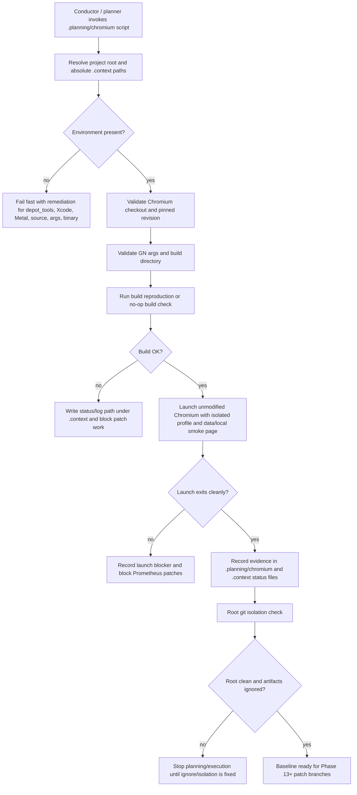

# Phase 12: Chromium Checkout, Build, and Patch Discipline - Research

**Researched:** 2026-06-23 [VERIFIED: system date]
**Domain:** macOS Chromium checkout/build workflow, local artifact isolation, and patch discipline [VERIFIED: .planning/ROADMAP.md]
**Confidence:** HIGH for official Chromium checkout/build commands and current local environment; MEDIUM for launch-shutdown automation details that still need implementation-time proof. [CITED: https://chromium.googlesource.com/chromium/src/+/main/docs/mac_build_instructions.md] [VERIFIED: local command audit]

<user_constraints>
## User Constraints (from CONTEXT.md)

The following locked decisions, discretion areas, and deferred scope are copied from `.planning/phases/12-chromium-checkout-build-and-patch-discipline/12-CONTEXT.md`. [VERIFIED: .planning/phases/12-chromium-checkout-build-and-patch-discipline/12-CONTEXT.md]

### Locked Decisions

## Implementation Decisions

### Unmodified Launch Proof
- **D-01:** A passing launch check requires the built Chromium app to start, open a local or `data:` smoke page, exit cleanly, and leave recorded evidence.
- **D-02:** The normal launch path should be attempted by default. Document `--disable-features=DialMediaRouteProvider` as a macOS development workaround for repeated local network permission prompt noise, but do not make it the default baseline proof unless needed.
- **D-03:** Phase 12 evidence should record the launch command, Chromium revision, GN args, status, and log/status file paths. Full stdout/stderr transcripts are not required unless needed for failure diagnosis.
- **D-04:** If the clean Chromium build succeeds but unmodified launch verification fails, Prometheus-specific Chromium patches are blocked until the launch blocker is fixed or explicitly documented as a launch blocker.

### Build And Run Scripts
- **D-05:** Add small planning-owned scripts under `.planning/chromium/` for environment checks, GN/build reproduction, and unmodified launch smoke. Do not add root-level product scripts in this phase.
- **D-06:** Scripts should verify the existing checkout at `.context/chromium/src` and provide remediation when it is missing. They should not run `fetch chromium` automatically during normal validation because checkout is large, slow, and risky in agent runs.
- **D-07:** Environment checks should fail fast with exact remediation for Xcode, Metal toolchain, depot_tools, GN args, Chromium source path, build directory, and binary path before running long commands.
- **D-08:** Scripts must be Conductor-friendly: use explicit paths and environment variables, avoid fixed ports and global state, avoid relying on interactive shell profile setup, and write predictable logs/status files.

### Patch Discipline
- **D-09:** Future Chromium source modifications happen inside `.context/chromium/src` and are managed by the Chromium checkout's git state. The root Prometheus planning repo stores docs, scripts, evidence, and exported patch guidance, not copied Chromium source files.
- **D-10:** Phase 12 should add or verify isolation gates for `.context/`, `.gclient`, Chromium `out/`, depot_tools, logs, caches, and build artifacts so the root repo cannot accidentally commit massive generated directories.
- **D-11:** Record the upstream Chromium baseline revision and define future patch branch/export expectations before branding work starts. Do not commit Prometheus changes directly on Chromium `main` without branch/export discipline.
- **D-12:** If root git becomes dirty because of Chromium checkout/build artifacts, planning or execution must stop until the artifact is cleaned, ignored, or isolated.

### the agent's Discretion
- Exact script filenames, shell helper structure, smoke-page content, and log/status file names are at the planner's discretion as long as the decisions above are satisfied.
- The planner may decide whether the isolation gate is implemented as shell, Node, or documented commands, provided it checks real root git tracking/ignore behavior.
- The planner may preserve the existing GN args unless a baseline validation issue requires changing them with documented rationale.

### Claude's Discretion

See "the agent's Discretion" above, copied verbatim from CONTEXT.md. [VERIFIED: .planning/phases/12-chromium-checkout-build-and-patch-discipline/12-CONTEXT.md]

### Deferred Ideas (OUT OF SCOPE)

## Deferred Ideas

None - discussion stayed within Phase 12 scope.
</user_constraints>

<phase_requirements>
## Phase Requirements

| ID | Description | Research Support |
|----|-------------|------------------|
| CHROM-01 | Developer can check out upstream Chromium using official `depot_tools`/`fetch chromium` workflow into a Prometheus-owned source location. [VERIFIED: .planning/REQUIREMENTS.md] | Use `.context/depot_tools` and `.context/chromium/src`; official Mac docs prescribe cloning depot_tools, adding an absolute depot_tools path, and running `fetch chromium`; local `.context/chromium/.gclient` validates successfully. [CITED: https://chromium.googlesource.com/chromium/src/+/main/docs/mac_build_instructions.md] [VERIFIED: `gclient validate`] |
| CHROM-02 | Developer can generate a local macOS Chromium build directory with GN and build the `chrome` target using Ninja/autoninja. [VERIFIED: .planning/REQUIREMENTS.md] | Official Mac docs prescribe `gn gen out/Default` and `autoninja -C out/Default chrome`; local `args.gn` and a no-op build check are valid for `out/Default`. [CITED: https://chromium.googlesource.com/chromium/src/+/main/docs/mac_build_instructions.md] [VERIFIED: `.context/chromium/src/out/Default/args.gn`; VERIFIED: `autoninja -C .context/chromium/src/out/Default -n chrome`] |
| CHROM-03 | Project documents minimum disk, time, SDK, Xcode, depot_tools, GN, and Ninja requirements for local Chromium development. [VERIFIED: .planning/REQUIREMENTS.md] | Official Mac docs document Mac, Xcode, macOS SDK, APFS, checkout timing, GN, Ninja, and launch commands; local audit adds actual disk size, Xcode, SDK, Metal, GN, and Ninja versions. [CITED: https://chromium.googlesource.com/chromium/src/+/main/docs/mac_build_instructions.md] [VERIFIED: local command audit] |
| CHROM-04 | Chromium source is kept in a patch-discipline structure that allows upstream rebases without mixing generated build output, local caches, or `.gclient` state into the root planning repo. [VERIFIED: .planning/REQUIREMENTS.md] | Chromium docs prescribe `git rebase-update` plus `gclient sync` for updates; depot_tools provides `git new-branch`; root repo currently ignores `.context/` through gitdir exclude but has no tracked `.gitignore`, so Phase 12 should add a reproducible isolation gate. [CITED: https://chromium.googlesource.com/chromium/src/+/main/docs/mac_build_instructions.md] [VERIFIED: `git new-branch --help`; VERIFIED: root git audit] |
| CHROM-05 | Project records the exact Chromium revision used as the Prometheus migration baseline. [VERIFIED: .planning/REQUIREMENTS.md] | Current Chromium revision is `0e8499df5172f55d0d29e2b92ef7e6a704529578`, commit date `2026-06-17 11:23:12 -0700`, subject `[Vertical Tabs] Implement Touch Handler`; the checkout is detached at that revision and `origin/main` points to it locally. [VERIFIED: `git -C .context/chromium/src show -s --format`] |
| CHROM-06 | Developer can run the unmodified Chromium app from the local build before Prometheus modifications begin. [VERIFIED: .planning/REQUIREMENTS.md] | Official Mac docs run `out/Default/Chromium.app/Contents/MacOS/Chromium`; local binary exists and is an arm64 Mach-O executable; launch smoke remains unverified and must be a blocking task. [CITED: https://chromium.googlesource.com/chromium/src/+/main/docs/mac_build_instructions.md] [VERIFIED: `test -x`; VERIFIED: `file`] |
| CHROM-07 | Project has a reproducible build/run script for macOS that fits Conductor/workspace constraints and avoids fixed-port or global-state conflicts where possible. [VERIFIED: .planning/REQUIREMENTS.md] | Scripts should live under `.planning/chromium/`, use absolute paths, avoid shell profile assumptions, use isolated launch profile state, and write status/log files under ignored `.context/`. [VERIFIED: .planning/phases/12-chromium-checkout-build-and-patch-discipline/12-CONTEXT.md] |
| CHROM-08 | Chromium checkout/build artifacts are excluded or isolated so the root repository does not accidentally commit massive generated directories. [VERIFIED: .planning/REQUIREMENTS.md] | Root git currently ignores `.context/` via `/Users/lakshman/conductor/repos/prometheus/.git/info/exclude`, tracks no `.context` files, and has no tracked `.gitignore`; Phase 12 should verify both ignore and tracking behavior in a script and consider adding a tracked ignore policy for fresh clones. [VERIFIED: `git check-ignore -v`; VERIFIED: `git ls-files`; VERIFIED: `.gitignore` file scan] |
</phase_requirements>

## Summary

Phase 12 should not rediscover the Chromium setup from scratch. The local workspace already has depot_tools under `.context/depot_tools`, a Chromium checkout under `.context/chromium/src`, a valid `.context/chromium/.gclient`, GN args in `out/Default/args.gn`, a built `Chromium.app`, and a no-op `autoninja` check that reports no work to do. [VERIFIED: .planning/chromium/CHROMIUM-CHECKOUT.md] [VERIFIED: local command audit]

The remaining planning work is to turn that local state into reproducible, Conductor-friendly evidence: environment check script, GN/build reproduction script, unmodified launch smoke script, root artifact-isolation gate, and updated baseline notes that record the Chromium revision, current depot_tools revision, GN args, build status, launch status, and future patch branch/export discipline. [VERIFIED: .planning/phases/12-chromium-checkout-build-and-patch-discipline/12-CONTEXT.md] [CITED: https://chromium.googlesource.com/chromium/src/+/main/docs/mac_build_instructions.md]

**Primary recommendation:** Preserve the existing `is_debug=false is_component_build=true symbol_level=0` baseline, add `.planning/chromium/` scripts that validate and reproduce it, make unmodified launch proof the phase gate, and block all Prometheus Chromium edits until the root repo remains clean and the launch evidence is recorded. [VERIFIED: `.context/chromium/src/out/Default/args.gn`] [VERIFIED: .planning/phases/12-chromium-checkout-build-and-patch-discipline/12-CONTEXT.md]

## Project Constraints (from AGENTS.md / CLAUDE.md)

No project `AGENTS.md`, `CLAUDE.md`, `.claude/skills/`, or `.agents/skills/` exists in this workspace. [VERIFIED: workspace file scan]

Use the phase context, roadmap, requirements, state, and existing `.planning/` script style as the local project authority. [VERIFIED: .planning/phases/12-chromium-checkout-build-and-patch-discipline/12-CONTEXT.md] [VERIFIED: .planning/preservation/verify-preservation.sh]

## Architectural Responsibility Map

| Capability | Primary Tier | Secondary Tier | Rationale |
|------------|--------------|----------------|-----------|
| Depot tools discovery/bootstrap | Developer Workstation | Root Planning Repo | `depot_tools` is an external toolchain under ignored `.context/`; root scripts should locate it by absolute path and report remediation, not vendor or commit it. [CITED: https://chromium.googlesource.com/chromium/tools/depot_tools.git] [VERIFIED: .planning/phases/12-chromium-checkout-build-and-patch-discipline/12-CONTEXT.md] |
| Chromium source checkout | Chromium External Workspace | Root Planning Repo | Source and `.gclient` state belong under `.context/chromium`; the root repo records evidence and scripts only. [VERIFIED: .planning/phases/12-chromium-checkout-build-and-patch-discipline/12-CONTEXT.md] [VERIFIED: `.context/chromium/.gclient`] |
| GN generation and `chrome` build | Chromium Build Output | macOS Toolchain | `gn gen` and `autoninja` operate inside `.context/chromium/src` and produce `out/Default`; Xcode SDK and Metal are workstation prerequisites. [CITED: https://chromium.googlesource.com/chromium/src/+/main/docs/mac_build_instructions.md] [VERIFIED: local command audit] |
| Unmodified launch proof | Built Chromium App | Root Planning Repo | The app launches from `out/Default/Chromium.app`; root evidence should record command, status, revision, GN args, and log/status paths. [CITED: https://chromium.googlesource.com/chromium/src/+/main/docs/mac_build_instructions.md] [VERIFIED: .planning/phases/12-chromium-checkout-build-and-patch-discipline/12-CONTEXT.md] |
| Patch discipline | Chromium Git Repository | Root Planning Repo | Future source edits are Chromium git commits/branches inside `.context/chromium/src`; root only stores docs, scripts, evidence, and exported patch guidance. [VERIFIED: .planning/phases/12-chromium-checkout-build-and-patch-discipline/12-CONTEXT.md] [VERIFIED: `git -C .context/chromium/src status --short`] |
| Artifact isolation | Root Git Repository | Chromium External Workspace | Root git must ignore or isolate `.context/`, `.gclient`, `out/`, depot_tools, logs, caches, and generated files before any build/launch evidence is accepted. [VERIFIED: `git check-ignore -v`; VERIFIED: .planning/phases/12-chromium-checkout-build-and-patch-discipline/12-CONTEXT.md] |

## Standard Stack

### Core

| Tool / Component | Verified Version / Revision | Purpose | Why Standard |
|------------------|-----------------------------|---------|--------------|
| Chromium source | `0e8499df5172f55d0d29e2b92ef7e6a704529578`; commit date `2026-06-17 11:23:12 -0700`. [VERIFIED: `git -C .context/chromium/src show -s --format`] | Browser source baseline. | Phase 12 must pin the exact upstream baseline before patches. [VERIFIED: .planning/REQUIREMENTS.md] |
| depot_tools | Local current `ea253a3e3ae7653cafd343be001dc5cbe69b3ad0`; commit date `2026-06-23 00:36:28 -0700`. [VERIFIED: `git -C .context/depot_tools show -s --format`] | Provides `fetch`, `gclient`, `git new-branch`, `git rebase-update`, `gn`, `autoninja`, and related Chromium tooling. | Chromium official docs require depot_tools for checkout/build workflows. [CITED: https://chromium.googlesource.com/chromium/tools/depot_tools.git] |
| `.context/chromium/.gclient` | Validated successfully. [VERIFIED: `gclient validate`] | Records the Chromium solution root and source URL. | `fetch chromium` creates `.gclient` and `src`; `gclient sync` updates dependencies. [CITED: https://chromium.googlesource.com/chromium/src/+/main/docs/mac_build_instructions.md] |
| GN | `2414 (a62eada32783)`. [VERIFIED: `.context/chromium/src/buildtools/mac/gn --version`] | Generates `.ninja` build files. | Official Mac docs use GN to create build directories. [CITED: https://chromium.googlesource.com/chromium/src/+/main/docs/mac_build_instructions.md] |
| autoninja / Ninja | `autoninja --version` reports `1.13.2`; Chromium bundled `third_party/ninja/ninja` reports `1.12.1`. [VERIFIED: local command audit] | Builds the `chrome` target. | Official Mac docs prescribe `autoninja -C out/Default chrome`; depot_tools describes autoninja as a wrapper for Siso and Ninja. [CITED: https://chromium.googlesource.com/chromium/src/+/main/docs/mac_build_instructions.md] [CITED: https://chromium.googlesource.com/chromium/tools/depot_tools.git] |
| Xcode / macOS SDK | Xcode `26.5` build `17F42`; SDKs include `MacOSX.sdk`, `MacOSX26.5.sdk`, `MacOSX26.sdk`. [VERIFIED: `xcodebuild -version`; VERIFIED: SDK directory scan] | Provides Apple SDK/toolchain prerequisites. | Official Mac docs list Xcode, macOS SDK, and APFS as system requirements. [CITED: https://chromium.googlesource.com/chromium/src/+/main/docs/mac_build_instructions.md] |
| Metal toolchain | `Apple metal version 32023.883`. [VERIFIED: `xcrun metal -v`] | Required by the current local Chromium build path after the prior Metal blocker. | Project state records the Metal blocker and its resolution. [VERIFIED: .planning/STATE.md] |

### Supporting

| Tool / Component | Verified Version / State | Purpose | When to Use |
|------------------|--------------------------|---------|-------------|
| Git | `2.50.1 (Apple Git-155)`. [VERIFIED: `git --version`] | Root artifact checks and Chromium patch branches. | Use for `git status`, `git rev-parse`, `git check-ignore`, `git ls-files`, Chromium branch creation, and patch export. [VERIFIED: local command audit] |
| Bash | `3.2.57(1)-release`. [VERIFIED: `bash --version`] | Portable macOS shell scripts. | Use for `.planning/chromium/*.sh` because prior verifier patterns are shell-based. [VERIFIED: .planning/preservation/verify-preservation.sh] |
| ripgrep | `15.1.0`. [VERIFIED: `rg --version`] | Fast static checks in verifier scripts. | Use where scripts need robust grep-like checks; preserve fallback only if needed. [VERIFIED: local command audit] |
| Python 3 | `3.14.3`. [VERIFIED: `python3 --version`] | depot_tools and optional script helpers. | Avoid depending on root virtualenv state; depot_tools can provide or bootstrap its own Python. [CITED: https://chromium.googlesource.com/chromium/tools/depot_tools.git] |
| osascript | Present enough to query Finder bundle ID. [VERIFIED: `osascript -e 'id of app "Finder"'`] | Candidate clean shutdown mechanism for launch smoke. | Validate against `org.chromium.Chromium` during implementation before treating it as the clean-exit proof. [ASSUMED] |

### Alternatives Considered

| Instead of | Could Use | Tradeoff |
|------------|-----------|----------|
| `fetch chromium` through depot_tools | Plain `git clone` of `chromium/src.git` plus manual dependency setup | Do not use for Phase 12 because official checkout flow uses `fetch`/`gclient` to create `.gclient`, sync dependencies, and run hooks. [CITED: https://chromium.googlesource.com/chromium/src/+/main/docs/mac_build_instructions.md] |
| `autoninja -C out/Default chrome` | Direct `ninja -C out/Default chrome` | Prefer `autoninja` because official docs call it the wrapper that supplies optimal Ninja arguments. [CITED: https://chromium.googlesource.com/chromium/src/+/main/docs/mac_build_instructions.md] |
| Root product scripts | `.planning/chromium/*.sh` scripts | Use planning-owned scripts because Phase 12 validates local workflow and must not create root-level product runtime APIs yet. [VERIFIED: .planning/phases/12-chromium-checkout-build-and-patch-discipline/12-CONTEXT.md] |
| Root repo committed Chromium source | Ignored `.context/chromium/src` external workspace | Use `.context` because the source/build tree is large and must stay outside accidental root commits. [VERIFIED: .planning/phases/12-chromium-checkout-build-and-patch-discipline/12-CONTEXT.md] |

**Installation / reproduction:**

```bash
# Source: Chromium Mac build instructions and local phase handoff.
git clone https://chromium.googlesource.com/chromium/tools/depot_tools.git .context/depot_tools
mkdir -p .context/chromium
cd .context/chromium
PATH="/Users/lakshman/conductor/workspaces/prometheus/puebla/.context/depot_tools:$PATH" fetch --no-history chromium
cd /Users/lakshman/conductor/workspaces/prometheus/puebla/.context/chromium/src
PATH="/Users/lakshman/conductor/workspaces/prometheus/puebla/.context/depot_tools:$PATH" \
DEVELOPER_DIR=/Applications/Xcode.app/Contents/Developer \
./buildtools/mac/gn gen out/Default --args='is_debug=false is_component_build=true symbol_level=0'
PATH="/Users/lakshman/conductor/workspaces/prometheus/puebla/.context/depot_tools:$PATH" \
DEVELOPER_DIR=/Applications/Xcode.app/Contents/Developer \
AI_AGENT=1 autoninja -C out/Default chrome
```

**Version verification:** This phase has no npm package stack; versions were verified with local tool commands and Git commit metadata instead of `npm view`. [VERIFIED: local command audit]

## Architecture Patterns

### System Architecture Diagram



The diagram is derived from the locked Phase 12 decisions and official Chromium build flow. [VERIFIED: .planning/phases/12-chromium-checkout-build-and-patch-discipline/12-CONTEXT.md] [CITED: https://chromium.googlesource.com/chromium/src/+/main/docs/mac_build_instructions.md]

### Recommended Project Structure

Recommended structure is planning-owned and keeps Chromium source/build output out of root git. [VERIFIED: .planning/phases/12-chromium-checkout-build-and-patch-discipline/12-CONTEXT.md]

```text
.planning/
  chromium/
    CHROMIUM-CHECKOUT.md
    check-chromium-env.sh
    build-chromium-baseline.sh
    smoke-launch-unmodified.sh
    verify-artifact-isolation.sh
.context/
  depot_tools/
  chromium/
    .gclient
    src/
      out/Default/
```

### Pattern 1: Absolute Toolchain Paths

**What:** Resolve `PROJECT_ROOT`, `DEPOT_TOOLS`, `CHROMIUM_ROOT`, `CHROMIUM_SRC`, `BUILD_DIR`, and `CHROMIUM_BIN` inside each script, then export an absolute depot_tools path. [VERIFIED: .planning/phases/12-chromium-checkout-build-and-patch-discipline/12-CONTEXT.md]

**When to use:** Use in every `.planning/chromium/` script to avoid interactive shell profile assumptions and relative depot_tools bootstrap issues. [VERIFIED: local depot_tools probe]

**Example:**

```bash
#!/usr/bin/env bash
set -euo pipefail

# Source: Chromium docs require an absolute depot_tools path for Python infra tools.
# [CITED: https://chromium.googlesource.com/chromium/src/+/main/docs/mac_build_instructions.md]
SCRIPT_DIR="$(cd "$(dirname "${BASH_SOURCE[0]}")" && pwd)"
PROJECT_ROOT="$(cd "${SCRIPT_DIR}/../.." && pwd)"
DEPOT_TOOLS="${PROJECT_ROOT}/.context/depot_tools"
CHROMIUM_SRC="${PROJECT_ROOT}/.context/chromium/src"
export PATH="${DEPOT_TOOLS}:${PATH}"
export DEVELOPER_DIR="${DEVELOPER_DIR:-/Applications/Xcode.app/Contents/Developer}"
```

### Pattern 2: Fail Fast Before Long Commands

**What:** Check required files, tools, versions, and paths before any fetch, GN generation, build, or launch attempt. [VERIFIED: .planning/phases/12-chromium-checkout-build-and-patch-discipline/12-CONTEXT.md]

**When to use:** Use at the top of build and launch scripts because Chromium commands can run for minutes or hours. [CITED: https://chromium.googlesource.com/chromium/src/+/main/docs/mac_build_instructions.md]

**Example:**

```bash
fail() {
  printf 'chromium baseline check failed: %s\n' "$1" >&2
  exit 1
}

[ -x "${DEPOT_TOOLS}/gclient" ] || fail "missing depot_tools at ${DEPOT_TOOLS}; clone official depot_tools first"
[ -d "${CHROMIUM_SRC}/.git" ] || fail "missing Chromium checkout at ${CHROMIUM_SRC}; run fetch manually from .context/chromium"
[ -x "${CHROMIUM_SRC}/buildtools/mac/gn" ] || fail "missing GN binary under Chromium buildtools"
[ -x "${CHROMIUM_SRC}/out/Default/Chromium.app/Contents/MacOS/Chromium" ] || fail "missing built Chromium binary; run baseline build"
```

### Pattern 3: Evidence Files Are Small and Predictable

**What:** Write status files and concise evidence under `.context/` or `.planning/chromium/`, but do not store full build logs in root unless diagnosing failure. [VERIFIED: .planning/phases/12-chromium-checkout-build-and-patch-discipline/12-CONTEXT.md]

**When to use:** Use for build status, launch status, launch command, Chromium revision, GN args, and log paths. [VERIFIED: .planning/chromium/CHROMIUM-CHECKOUT.md]

**Example:**

```bash
REVISION="$(git -C "${CHROMIUM_SRC}" rev-parse HEAD)"
ARGS="$(tr '\n' ' ' < "${CHROMIUM_SRC}/out/Default/args.gn")"
printf 'revision=%s\nargs=%s\nstatus=%s\nlog=%s\n' \
  "${REVISION}" "${ARGS}" "${status}" "${log_file}" > "${PROJECT_ROOT}/.context/chromium-launch.status"
```

### Pattern 4: Patch Branch Before Source Edits

**What:** Create named Chromium git branches from the pinned baseline before later Prometheus source edits. [VERIFIED: current checkout is detached at baseline] [VERIFIED: `git new-branch --help`]

**When to use:** Use in later phases before branding, resources, Views, WebUI, or agent-service changes. [VERIFIED: .planning/ROADMAP.md]

**Example:**

```bash
# Source: depot_tools git-new-branch manpage says new branches track origin/main by default.
# [VERIFIED: `git new-branch --help`]
cd /Users/lakshman/conductor/workspaces/prometheus/puebla/.context/chromium/src
PATH="/Users/lakshman/conductor/workspaces/prometheus/puebla/.context/depot_tools:$PATH" \
  git new-branch prometheus/phase-13-branding
```

### Anti-Patterns to Avoid

- **Auto-running `fetch chromium` in validation:** Checkout is large and official docs warn it can take 30 minutes on fast connections and many hours on slower ones; scripts should detect missing checkout and print remediation. [CITED: https://chromium.googlesource.com/chromium/src/+/main/docs/mac_build_instructions.md] [VERIFIED: .planning/phases/12-chromium-checkout-build-and-patch-discipline/12-CONTEXT.md]
- **Using relative depot_tools paths:** Official docs require an absolute depot_tools path; a relative local invocation emitted a CIPD bootstrap warning on this mac-arm64 machine. [CITED: https://chromium.googlesource.com/chromium/src/+/main/docs/mac_build_instructions.md] [VERIFIED: local depot_tools probe]
- **Treating build success as launch success:** Phase 12 has separate success criteria for `autoninja` and unmodified launch. [VERIFIED: .planning/ROADMAP.md] [VERIFIED: .planning/phases/12-chromium-checkout-build-and-patch-discipline/12-CONTEXT.md]
- **Committing generated Chromium artifacts to root:** Root git should never track `.context/`, `.gclient`, `out/`, depot_tools, logs, caches, or generated artifacts. [VERIFIED: .planning/phases/12-chromium-checkout-build-and-patch-discipline/12-CONTEXT.md]
- **Editing detached Chromium HEAD directly:** Current source checkout is detached at the baseline revision, so later source changes need named branches to survive rebase/export discipline. [VERIFIED: `git -C .context/chromium/src branch --show-current`; VERIFIED: `git log -1 --decorate`]

## Don't Hand-Roll

| Problem | Don't Build | Use Instead | Why |
|---------|-------------|-------------|-----|
| Chromium checkout and dependency graph | Custom Git clone plus ad hoc DEPS parser | `fetch chromium` and `gclient sync` | Official flow creates `.gclient`, `src`, dependency checkout state, and hooks. [CITED: https://chromium.googlesource.com/chromium/src/+/main/docs/mac_build_instructions.md] |
| Build-file generation | Custom Ninja file generator | GN | Official Mac docs use GN for Chromium build directories. [CITED: https://chromium.googlesource.com/chromium/src/+/main/docs/mac_build_instructions.md] |
| Build orchestration | Raw compiler invocations or root Makefiles | `autoninja -C out/Default chrome` | Official docs prescribe autoninja, and depot_tools identifies autoninja as the wrapper for Siso/Ninja. [CITED: https://chromium.googlesource.com/chromium/src/+/main/docs/mac_build_instructions.md] [CITED: https://chromium.googlesource.com/chromium/tools/depot_tools.git] |
| Chromium patch workflow | Root repo copies of Chromium files | Chromium git branches plus exported guidance | The root repo stores docs/scripts/evidence; source edits belong in `.context/chromium/src`. [VERIFIED: .planning/phases/12-chromium-checkout-build-and-patch-discipline/12-CONTEXT.md] |
| Launch profile management | Reusing default user profile | Temporary `--user-data-dir` and `--no-first-run` launch args | Chromium docs allow overriding user data dir; Chromium source documents `--no-first-run` as automation-oriented prompt suppression. [CITED: https://chromium.googlesource.com/chromium/src/+/HEAD/docs/user_data_dir.md] [CITED: https://chromium.googlesource.com/chromium/src/+/master/chrome/common/chrome_switches.cc] |

**Key insight:** Phase 12 should standardize evidence and guardrails around the official Chromium toolchain; replacing depot_tools/GN/autoninja with project-local equivalents creates rebase and dependency drift risk without solving a Phase 12 requirement. [CITED: https://chromium.googlesource.com/chromium/src/+/main/docs/mac_build_instructions.md] [VERIFIED: .planning/REQUIREMENTS.md]

## Runtime State Inventory

This is an engine-migration baseline phase rather than a string rename; the inventory below covers runtime/build state that remains after root files are updated. [VERIFIED: .planning/ROADMAP.md]

| Category | Items Found | Action Required |
|----------|-------------|-----------------|
| Stored data | None for application data in Phase 12; no database/datastore participates in the Chromium baseline proof. [VERIFIED: phase scope audit] | None. [VERIFIED: phase scope audit] |
| Live service config | None; Phase 12 uses local files and command-line tools, not external service configuration. [VERIFIED: .planning/ROADMAP.md] | None. [VERIFIED: phase scope audit] |
| OS-registered state | Active developer directory is `/Applications/Xcode.app/Contents/Developer`; Xcode license/first-launch and Metal Toolchain are already resolved; future launch may trigger macOS Keychain/network permission prompts. [VERIFIED: `xcode-select -p`; VERIFIED: .planning/STATE.md] [CITED: https://chromium.googlesource.com/chromium/src/+/main/docs/mac_build_instructions.md] | Scripts should check `xcode-select -p`, `xcodebuild -version`, `xcrun metal -v`, and document optional prompt workaround flags. [VERIFIED: local command audit] |
| Secrets/env vars | No Phase 12 secrets are required; `DEVELOPER_DIR`, `PATH`, and `AI_AGENT` are operational env vars only. [VERIFIED: .planning/chromium/CHROMIUM-CHECKOUT.md] | Scripts should set or print env vars explicitly and avoid reading shell profile state. [VERIFIED: .planning/phases/12-chromium-checkout-build-and-patch-discipline/12-CONTEXT.md] |
| Build artifacts | `.context/chromium` is 37G; `.context/chromium/src/out/Default` is 7.8G; `.context/depot_tools` is 700M; `.context/chromium-build-screen.status` is `0`; root git ignores `.context/` through gitdir exclude. [VERIFIED: `du -sh`; VERIFIED: `cat .context/chromium-build-screen.status`; VERIFIED: `git check-ignore -v`] | Keep artifacts under `.context/`; add scriptable isolation checks and update notes after launch. [VERIFIED: .planning/phases/12-chromium-checkout-build-and-patch-discipline/12-CONTEXT.md] |

## Common Pitfalls

### Pitfall 1: Relative depot_tools Path
**What goes wrong:** depot_tools bootstrap can look for CIPD/support files through the wrong relative path. [VERIFIED: local relative `gclient --version` probe]
**Why it happens:** Official Mac docs require an absolute depot_tools path so Python can find infra tools. [CITED: https://chromium.googlesource.com/chromium/src/+/main/docs/mac_build_instructions.md]
**How to avoid:** Resolve `DEPOT_TOOLS="${PROJECT_ROOT}/.context/depot_tools"` and prepend that absolute path to `PATH`. [VERIFIED: local absolute PATH probe]
**Warning signs:** CIPD bootstrap warnings, missing `cipd_client_version.digests`, or scripts that work only from one current directory. [VERIFIED: local relative `gclient --version` probe]

### Pitfall 2: depot_tools Auto-Update Changes the Recorded Tool Revision
**What goes wrong:** Running `gclient` can update depot_tools, so handoff docs can become stale. [CITED: https://chromium.googlesource.com/chromium/tools/depot_tools.git] [VERIFIED: local depot_tools changed to `ea253a3e3ae7` during audit]
**Why it happens:** depot_tools auto-updates when running `gclient` unless update is disabled. [CITED: https://chromium.googlesource.com/chromium/tools/depot_tools.git]
**How to avoid:** Record the post-validation depot_tools revision in Phase 12 evidence and avoid treating the old `c46c2e905` handoff revision as current. [VERIFIED: .planning/chromium/CHROMIUM-CHECKOUT.md] [VERIFIED: `git -C .context/depot_tools rev-parse`]
**Warning signs:** `.planning/chromium/CHROMIUM-CHECKOUT.md` revision differs from `git -C .context/depot_tools rev-parse HEAD`. [VERIFIED: local command audit]

### Pitfall 3: Detached Chromium HEAD Edits
**What goes wrong:** Edits made on detached HEAD are hard to rebase, export, or recover. [VERIFIED: current checkout detached at baseline]
**Why it happens:** The current source checkout points directly at the recorded baseline commit. [VERIFIED: `git -C .context/chromium/src log -1 --decorate`]
**How to avoid:** Later phases should create named Chromium branches before source edits and record patch export expectations. [VERIFIED: `git new-branch --help`] [VERIFIED: .planning/phases/12-chromium-checkout-build-and-patch-discipline/12-CONTEXT.md]
**Warning signs:** `git -C .context/chromium/src branch --show-current` prints nothing. [VERIFIED: local command audit]

### Pitfall 4: Root Git Pollution
**What goes wrong:** Chromium checkout/build artifacts can dirty the root planning repo or get committed accidentally. [VERIFIED: .planning/REQUIREMENTS.md]
**Why it happens:** `.context/` is currently ignored only via the shared gitdir exclude and there is no tracked root `.gitignore`. [VERIFIED: `git check-ignore -v`; VERIFIED: `.gitignore` scan]
**How to avoid:** Add a reproducible isolation verifier that checks `git check-ignore`, `git ls-files`, and `git status --short` before and after scripts; consider a tracked `.gitignore` if planner wants fresh-clone protection. [VERIFIED: .planning/phases/12-chromium-checkout-build-and-patch-discipline/12-CONTEXT.md]
**Warning signs:** Root `git status --short` shows `.context`, `.gclient`, `out`, depot_tools, logs, or caches. [VERIFIED: .planning/phases/12-chromium-checkout-build-and-patch-discipline/12-CONTEXT.md]

### Pitfall 5: Launch Smoke Pollutes User Profile or Hangs on Prompts
**What goes wrong:** Unmodified launch proof can open the default Chromium profile, trigger first-run/default-browser prompts, or hang on macOS permission dialogs. [CITED: https://chromium.googlesource.com/chromium/src/+/main/docs/mac_build_instructions.md] [CITED: https://chromium.googlesource.com/chromium/src/+/master/chrome/common/chrome_switches.cc]
**Why it happens:** Chromium developer builds can show Keychain and network permission prompts, and normal profiles introduce stateful behavior. [CITED: https://chromium.googlesource.com/chromium/src/+/main/docs/mac_build_instructions.md]
**How to avoid:** Use a temporary `--user-data-dir`, `--no-first-run`, `--no-default-browser-check`, and a local/data smoke page; use `--disable-features=DialMediaRouteProvider` only as the documented workaround if needed. [CITED: https://chromium.googlesource.com/chromium/src/+/HEAD/docs/user_data_dir.md] [CITED: https://chromium.googlesource.com/chromium/src/+/master/chrome/common/chrome_switches.cc] [VERIFIED: .planning/phases/12-chromium-checkout-build-and-patch-discipline/12-CONTEXT.md]
**Warning signs:** Smoke run leaves a persistent profile, blocks on dialogs, or only passes with workaround flags without documenting why. [VERIFIED: .planning/phases/12-chromium-checkout-build-and-patch-discipline/12-CONTEXT.md]

### Pitfall 6: Rebase Without Dependency Sync
**What goes wrong:** Source rebases can leave third-party dependencies stale and break later builds. [CITED: https://chromium.googlesource.com/chromium/src/+/main/docs/commit_checklist.md]
**Why it happens:** Chromium docs say to run `gclient sync` after `git rebase-update` because dependencies need matching revisions. [CITED: https://chromium.googlesource.com/chromium/src/+/main/docs/commit_checklist.md]
**How to avoid:** Future patch discipline should pair `git rebase-update` or branch rebases with `gclient sync`, then rerun GN/build checks. [CITED: https://chromium.googlesource.com/chromium/src/+/main/docs/mac_build_instructions.md]
**Warning signs:** Build errors after a source update with no matching `gclient sync`. [CITED: https://chromium.googlesource.com/chromium/src/+/main/docs/commit_checklist.md]

## Code Examples

Verified patterns from official sources and local state. [CITED: https://chromium.googlesource.com/chromium/src/+/main/docs/mac_build_instructions.md] [VERIFIED: local command audit]

### Environment Check Skeleton

```bash
#!/usr/bin/env bash
set -euo pipefail

# Source: Phase 12 decisions and Chromium Mac build docs.
# [VERIFIED: .planning/phases/12-chromium-checkout-build-and-patch-discipline/12-CONTEXT.md]
# [CITED: https://chromium.googlesource.com/chromium/src/+/main/docs/mac_build_instructions.md]
SCRIPT_DIR="$(cd "$(dirname "${BASH_SOURCE[0]}")" && pwd)"
PROJECT_ROOT="$(cd "${SCRIPT_DIR}/../.." && pwd)"
DEPOT_TOOLS="${PROJECT_ROOT}/.context/depot_tools"
CHROMIUM_SRC="${PROJECT_ROOT}/.context/chromium/src"
BUILD_DIR="${CHROMIUM_SRC}/out/Default"
CHROMIUM_BIN="${BUILD_DIR}/Chromium.app/Contents/MacOS/Chromium"
export PATH="${DEPOT_TOOLS}:${PATH}"
export DEVELOPER_DIR="${DEVELOPER_DIR:-/Applications/Xcode.app/Contents/Developer}"

fail() { printf 'chromium env check failed: %s\n' "$1" >&2; exit 1; }

[ -d "${DEPOT_TOOLS}/.git" ] || fail "missing depot_tools at ${DEPOT_TOOLS}"
[ -d "${CHROMIUM_SRC}/.git" ] || fail "missing Chromium source at ${CHROMIUM_SRC}"
[ -f "${BUILD_DIR}/args.gn" ] || fail "missing ${BUILD_DIR}/args.gn"
[ -x "${CHROMIUM_BIN}" ] || fail "missing executable Chromium binary at ${CHROMIUM_BIN}"
xcodebuild -version >/dev/null || fail "xcodebuild unavailable; install/select full Xcode"
xcrun metal -v >/dev/null || fail "Metal toolchain unavailable; run xcodebuild -downloadComponent MetalToolchain"
```

### Build Reproduction Command

```bash
# Source: official Chromium Mac build docs and existing Phase 12 args.
# [CITED: https://chromium.googlesource.com/chromium/src/+/main/docs/mac_build_instructions.md]
# [VERIFIED: .context/chromium/src/out/Default/args.gn]
cd /Users/lakshman/conductor/workspaces/prometheus/puebla/.context/chromium/src
PATH="/Users/lakshman/conductor/workspaces/prometheus/puebla/.context/depot_tools:$PATH" \
DEVELOPER_DIR=/Applications/Xcode.app/Contents/Developer \
./buildtools/mac/gn gen out/Default --args='is_debug=false is_component_build=true symbol_level=0'

AI_AGENT=1 \
PATH="/Users/lakshman/conductor/workspaces/prometheus/puebla/.context/depot_tools:$PATH" \
DEVELOPER_DIR=/Applications/Xcode.app/Contents/Developer \
autoninja -C out/Default chrome
```

### Launch Smoke Shape

```bash
# Source: Chromium Mac run command, user-data-dir docs, and chrome switches source.
# [CITED: https://chromium.googlesource.com/chromium/src/+/main/docs/mac_build_instructions.md]
# [CITED: https://chromium.googlesource.com/chromium/src/+/HEAD/docs/user_data_dir.md]
# [CITED: https://chromium.googlesource.com/chromium/src/+/master/chrome/common/chrome_switches.cc]
profile_dir="$(mktemp -d "${PROJECT_ROOT}/.context/chromium-smoke-profile.XXXXXX")"
log_file="${PROJECT_ROOT}/.context/chromium-launch.log"
status_file="${PROJECT_ROOT}/.context/chromium-launch.status"

"${CHROMIUM_BIN}" \
  --user-data-dir="${profile_dir}" \
  --no-first-run \
  --no-default-browser-check \
  'data:text/html,<title>Prometheus Chromium Baseline Smoke</title><h1>OK</h1>' \
  >"${log_file}" 2>&1 &
pid="$!"

sleep 5
osascript -e 'tell application id "org.chromium.Chromium" to quit' || true
wait "${pid}"
printf 'status=%s\nlog=%s\nprofile=%s\n' "$?" "${log_file}" "${profile_dir}" > "${status_file}"
```

Implementation must validate the `osascript` shutdown path before using it as proof of clean exit. [ASSUMED]

### Root Artifact Isolation Gate

```bash
# Source: Phase 12 patch-discipline decisions and current root git audit.
# [VERIFIED: .planning/phases/12-chromium-checkout-build-and-patch-discipline/12-CONTEXT.md]
git check-ignore -q .context/chromium/src/out || {
  printf '.context/chromium/src/out is not ignored by root git\n' >&2
  exit 1
}

if git ls-files -- .context .gclient out depot_tools | rg -q .; then
  printf 'root git tracks Chromium/depot_tools artifacts\n' >&2
  exit 1
fi

if git status --short | rg '(^|\s)(\.context|\.gclient|out/|depot_tools)'; then
  printf 'root git dirty with Chromium/depot_tools artifacts\n' >&2
  exit 1
fi
```

## State of the Art

| Old Approach | Current Approach | When Changed | Impact |
|--------------|------------------|--------------|--------|
| Full-history checkout by default | `fetch --no-history chromium` is documented as a time-saving option and can be unshallowed later. [CITED: https://chromium.googlesource.com/chromium/src/+/main/docs/mac_build_instructions.md] | Current official Mac docs as read on 2026-06-23. [CITED: https://chromium.googlesource.com/chromium/src/+/main/docs/mac_build_instructions.md] | Phase 12 may preserve the existing shallow checkout but must record exact revision and limitation. [VERIFIED: .planning/chromium/CHROMIUM-CHECKOUT.md] |
| Direct `ninja` usage as the primary command | Official docs prescribe `autoninja`, and depot_tools describes autoninja as wrapping Siso/Ninja. [CITED: https://chromium.googlesource.com/chromium/src/+/main/docs/mac_build_instructions.md] [CITED: https://chromium.googlesource.com/chromium/tools/depot_tools.git] | Current official docs as read on 2026-06-23. [CITED: https://chromium.googlesource.com/chromium/src/+/main/docs/mac_build_instructions.md] | Scripts should call `autoninja -C out/Default chrome`, not raw compiler or root build wrappers. [CITED: https://chromium.googlesource.com/chromium/src/+/main/docs/mac_build_instructions.md] |
| Debug default build for first local baseline | Existing baseline uses `is_debug=false is_component_build=true symbol_level=0`, which official docs list as faster-build args. [CITED: https://chromium.googlesource.com/chromium/src/+/main/docs/mac_build_instructions.md] [VERIFIED: `.context/chromium/src/out/Default/args.gn`] | Selected in existing handoff on 2026-06-17. [VERIFIED: .planning/chromium/CHROMIUM-CHECKOUT.md] | Preserve these args unless launch/build validation proves a need to change them. [VERIFIED: .planning/phases/12-chromium-checkout-build-and-patch-discipline/12-CONTEXT.md] |
| Xcode as build driver | Official Mac docs say most people build in Terminal and Xcode-Ninja hybrid is unsupported for build driving. [CITED: https://chromium.googlesource.com/chromium/src/+/main/docs/mac_build_instructions.md] | Current official docs as read on 2026-06-23. [CITED: https://chromium.googlesource.com/chromium/src/+/main/docs/mac_build_instructions.md] | Do not add Xcode project generation to Phase 12 unless needed for debugging. [CITED: https://chromium.googlesource.com/chromium/src/+/main/docs/mac_build_instructions.md] |
| Relying on global shell profile PATH | Scripts should set explicit absolute paths because official docs require absolute depot_tools path. [CITED: https://chromium.googlesource.com/chromium/src/+/main/docs/mac_build_instructions.md] | Locked by Phase 12 context. [VERIFIED: .planning/phases/12-chromium-checkout-build-and-patch-discipline/12-CONTEXT.md] | Conductor can run scripts without interactive shell state. [VERIFIED: .planning/phases/12-chromium-checkout-build-and-patch-discipline/12-CONTEXT.md] |

**Deprecated/outdated:**
- Treating `c46c2e905` as the current depot_tools revision is outdated after local `gclient` probing; current local depot_tools HEAD is `ea253a3e3ae7653cafd343be001dc5cbe69b3ad0`. [VERIFIED: .planning/chromium/CHROMIUM-CHECKOUT.md] [VERIFIED: `git -C .context/depot_tools rev-parse HEAD`]
- Treating unmodified launch verification as already complete is outdated; build finished successfully, but launch remains pending. [VERIFIED: .planning/STATE.md] [VERIFIED: .planning/chromium/CHROMIUM-CHECKOUT.md]

## Assumptions Log

| # | Claim | Section | Risk if Wrong |
|---|-------|---------|---------------|
| A1 | Keep at least 100GB free disk as an operational planning buffer for Chromium source plus build outputs. [ASSUMED] | Environment Availability / Open Questions | Planner may understate disk needs; local current source plus one build is about 45G, but future builds/caches can grow. [VERIFIED: `du -sh`; ASSUMED] |
| A2 | `osascript -e 'tell application id "org.chromium.Chromium" to quit'` can be the clean shutdown mechanism for launch smoke. [ASSUMED] | Code Examples / Validation Architecture | Launch script may need a different quit strategy, such as app name, PID-aware AppleScript, or documented manual fallback. [ASSUMED] |

## Open Questions

1. **Should Phase 12 add a tracked root `.gitignore`?**
   - What we know: `.context/` is ignored through `/Users/lakshman/conductor/repos/prometheus/.git/info/exclude`; no tracked root `.gitignore` exists. [VERIFIED: `git check-ignore -v`; VERIFIED: `.gitignore` scan]
   - What's unclear: Whether this workspace-specific exclude is acceptable for fresh clones or whether a tracked ignore file is required. [VERIFIED: .planning/phases/12-chromium-checkout-build-and-patch-discipline/12-CONTEXT.md]
   - Recommendation: Add a tracked root `.gitignore` with `.context/`, `.gclient`, `out/`, depot_tools, and build-log patterns unless the planner intentionally keeps isolation local-only. [ASSUMED]

2. **What exact launch success signal should the smoke script require?**
   - What we know: User decisions require start, local/data smoke page, clean exit, and recorded evidence. [VERIFIED: .planning/phases/12-chromium-checkout-build-and-patch-discipline/12-CONTEXT.md]
   - What's unclear: Whether process start plus clean quit is sufficient or whether the script must inspect a window/tab title. [ASSUMED]
   - Recommendation: Plan a pragmatic first smoke that starts the process with isolated profile, waits for process liveness, requests quit by bundle ID, records exit status, and marks deeper UI inspection as optional only if launch hangs or fails. [ASSUMED]

3. **Should depot_tools auto-update be allowed in future validation?**
   - What we know: depot_tools auto-updated during `gclient`; official depot_tools docs state this is normal unless disabled. [CITED: https://chromium.googlesource.com/chromium/tools/depot_tools.git] [VERIFIED: local command audit]
   - What's unclear: Whether Prometheus wants reproducible tool revision pinning or current depot_tools by default. [ASSUMED]
   - Recommendation: Record the actual depot_tools revision after validation and do not disable auto-update unless a toolchain regression appears. [ASSUMED]

## Environment Availability

| Dependency | Required By | Available | Version / State | Fallback |
|------------|-------------|-----------|-----------------|----------|
| macOS arm64 workstation | Chromium macOS build | Yes | `uname -m` is `arm64`. [VERIFIED: `uname -m`] | None for this macOS-first phase. [VERIFIED: .planning/ROADMAP.md] |
| Free disk | Checkout/build | Yes | Filesystem has `467Gi` available; `.context/chromium` is `37G`; `out/Default` is `7.8G`. [VERIFIED: `df -h`; VERIFIED: `du -sh`] | Clean old `.context` artifacts only after preserving required evidence. [ASSUMED] |
| Xcode | SDK/build toolchain | Yes | Xcode `26.5`, build `17F42`; active developer dir `/Applications/Xcode.app/Contents/Developer`. [VERIFIED: `xcodebuild -version`; VERIFIED: `xcode-select -p`] | Install/select full Xcode and accept license if missing. [CITED: https://chromium.googlesource.com/chromium/src/+/main/docs/mac_build_instructions.md] |
| macOS SDK | Build toolchain | Yes | SDKs include `MacOSX.sdk`, `MacOSX26.5.sdk`, `MacOSX26.sdk`. [VERIFIED: SDK directory scan] | Install/update Xcode. [CITED: https://chromium.googlesource.com/chromium/src/+/main/docs/mac_build_instructions.md] |
| Metal toolchain | ANGLE/Metal build path | Yes | `Apple metal version 32023.883`. [VERIFIED: `xcrun metal -v`] | Run `xcodebuild -downloadComponent MetalToolchain` if missing. [VERIFIED: .planning/chromium/CHROMIUM-CHECKOUT.md] |
| depot_tools | Checkout, gclient, autoninja, git extensions | Yes | `.context/depot_tools` current HEAD `ea253a3e3ae7`; clean. [VERIFIED: local command audit] | Clone official depot_tools into `.context/depot_tools`. [CITED: https://chromium.googlesource.com/chromium/src/+/main/docs/mac_build_instructions.md] |
| Chromium checkout | Source/build | Yes | `.context/chromium/src` at `0e8499df5172f55d0d29e2b92ef7e6a704529578`; detached at `origin/main`. [VERIFIED: local command audit] | Manual `fetch --no-history chromium`; do not auto-fetch inside validation scripts. [CITED: https://chromium.googlesource.com/chromium/src/+/main/docs/mac_build_instructions.md] [VERIFIED: .planning/phases/12-chromium-checkout-build-and-patch-discipline/12-CONTEXT.md] |
| GN | Generate build files | Yes | `2414 (a62eada32783)`. [VERIFIED: GN command] | Comes from Chromium checkout/buildtools. [VERIFIED: local command audit] |
| autoninja / Ninja | Build target | Yes | `autoninja --version` reports `1.13.2`; dry-run/no-op `chrome` build succeeds. [VERIFIED: local command audit] | Use depot_tools wrapper; do not substitute custom build system. [CITED: https://chromium.googlesource.com/chromium/src/+/main/docs/mac_build_instructions.md] |
| Built Chromium binary | Launch smoke | Yes | `out/Default/Chromium.app/Contents/MacOS/Chromium` is executable arm64. [VERIFIED: `test -x`; VERIFIED: `file`] | Rebuild `chrome` target. [VERIFIED: .planning/chromium/CHROMIUM-CHECKOUT.md] |
| osascript | Launch smoke shutdown candidate | Yes | Finder bundle query works. [VERIFIED: local command audit] | Use app-name quit or documented manual fallback if bundle-ID quit fails. [ASSUMED] |

**Missing dependencies with no fallback:**
- None detected for Phase 12 planning and local baseline validation. [VERIFIED: local command audit]

**Missing dependencies with fallback:**
- No conventional root test framework exists; Phase 12 should create shell validation scripts under `.planning/chromium/`. [VERIFIED: root test infrastructure scan]

## Validation Architecture

### Test Framework

| Property | Value |
|----------|-------|
| Framework | Bash script gates plus Chromium `gn`/`autoninja`; no root pytest/jest/vitest framework exists. [VERIFIED: root test infrastructure scan] |
| Config file | None for root tests; Chromium build config is `.context/chromium/src/out/Default/args.gn`. [VERIFIED: file scan] |
| Quick run command | `bash -n .planning/chromium/*.sh && bash .planning/chromium/check-chromium-env.sh && bash .planning/chromium/verify-artifact-isolation.sh` after scripts exist. [ASSUMED] |
| Full suite command | `bash .planning/chromium/check-chromium-env.sh && bash .planning/chromium/build-chromium-baseline.sh --no-op-ok && bash .planning/chromium/smoke-launch-unmodified.sh && bash .planning/chromium/verify-artifact-isolation.sh` after scripts exist. [ASSUMED] |

### Phase Requirements To Test Map

| Req ID | Behavior | Test Type | Automated Command | File Exists? |
|--------|----------|-----------|-------------------|--------------|
| CHROM-01 | Official checkout exists at agreed location with valid `.gclient`. [VERIFIED: .planning/REQUIREMENTS.md] | static/env | `bash .planning/chromium/check-chromium-env.sh` [ASSUMED] | No - Wave 0 script. [VERIFIED: .planning/chromium file scan] |
| CHROM-02 | GN args and `chrome` build target are reproducible. [VERIFIED: .planning/REQUIREMENTS.md] | build | `bash .planning/chromium/build-chromium-baseline.sh --no-op-ok` [ASSUMED] | No - Wave 0 script. [VERIFIED: .planning/chromium file scan] |
| CHROM-03 | Local requirements are documented. [VERIFIED: .planning/REQUIREMENTS.md] | static/docs | `rg 'Xcode|Metal|depot_tools|GN|Ninja|disk|time|SDK' .planning/chromium/CHROMIUM-CHECKOUT.md` [ASSUMED] | Partial - handoff exists; update needed. [VERIFIED: .planning/chromium/CHROMIUM-CHECKOUT.md] |
| CHROM-04 | Patch discipline separates Chromium git state from root repo. [VERIFIED: .planning/REQUIREMENTS.md] | static/git | `bash .planning/chromium/verify-artifact-isolation.sh` [ASSUMED] | No - Wave 0 script. [VERIFIED: .planning/chromium file scan] |
| CHROM-05 | Exact baseline revision is recorded. [VERIFIED: .planning/REQUIREMENTS.md] | static/git/docs | `test "$(git -C .context/chromium/src rev-parse HEAD)" = "$(rg -o '[0-9a-f]{40}' .planning/chromium/CHROMIUM-CHECKOUT.md | head -1)"` [ASSUMED] | Partial - handoff has old evidence; should update post-probe depot_tools too. [VERIFIED: .planning/chromium/CHROMIUM-CHECKOUT.md] |
| CHROM-06 | Unmodified Chromium launches and exits cleanly. [VERIFIED: .planning/REQUIREMENTS.md] | smoke/manual-capable | `bash .planning/chromium/smoke-launch-unmodified.sh` [ASSUMED] | No - Wave 0 script. [VERIFIED: .planning/chromium file scan] |
| CHROM-07 | Reproducible scripts run without interactive shell state or fixed ports. [VERIFIED: .planning/REQUIREMENTS.md] | script/static | `bash -n .planning/chromium/*.sh && rg 'PROJECT_ROOT|DEPOT_TOOLS|DEVELOPER_DIR|status' .planning/chromium` [ASSUMED] | No - Wave 0 scripts. [VERIFIED: .planning/chromium file scan] |
| CHROM-08 | Chromium artifacts are ignored/untracked by root git. [VERIFIED: .planning/REQUIREMENTS.md] | git/static | `bash .planning/chromium/verify-artifact-isolation.sh` [ASSUMED] | No - Wave 0 script. [VERIFIED: .planning/chromium file scan] |

### Sampling Rate

- **Per task commit:** Run `bash -n .planning/chromium/*.sh` plus the relevant focused script for files changed. [ASSUMED]
- **Per wave merge:** Run env check, artifact isolation, and no-op build check. [ASSUMED]
- **Phase gate:** Full suite including launch smoke must pass before `/gsd-verify-work`; if launch fails, Phase 12 must record a blocker and later Prometheus Chromium patches stay blocked. [VERIFIED: .planning/phases/12-chromium-checkout-build-and-patch-discipline/12-CONTEXT.md]

### Wave 0 Gaps

- [ ] `.planning/chromium/check-chromium-env.sh` - fail-fast checks for depot_tools, Xcode, SDK, Metal, source path, build dir, GN args, and binary. [VERIFIED: .planning/phases/12-chromium-checkout-build-and-patch-discipline/12-CONTEXT.md]
- [ ] `.planning/chromium/build-chromium-baseline.sh` - GN generation and `autoninja -C out/Default chrome` reproduction with predictable status/log output. [CITED: https://chromium.googlesource.com/chromium/src/+/main/docs/mac_build_instructions.md]
- [ ] `.planning/chromium/smoke-launch-unmodified.sh` - isolated-profile launch proof with data/local smoke page and status evidence. [VERIFIED: .planning/phases/12-chromium-checkout-build-and-patch-discipline/12-CONTEXT.md]
- [ ] `.planning/chromium/verify-artifact-isolation.sh` - root git ignore/tracking/dirty gate for `.context`, `.gclient`, `out`, depot_tools, logs, caches, and generated artifacts. [VERIFIED: .planning/phases/12-chromium-checkout-build-and-patch-discipline/12-CONTEXT.md]
- [ ] Update `.planning/chromium/CHROMIUM-CHECKOUT.md` after script results with current depot_tools revision, launch proof, and artifact-isolation evidence. [VERIFIED: .planning/chromium/CHROMIUM-CHECKOUT.md]

## Security Domain

### Applicable ASVS Categories

ASVS is used here as a lightweight checklist for local script safety rather than web-app security because Phase 12 does not expose an application endpoint. [CITED: https://owasp.org/www-project-application-security-verification-standard/] [VERIFIED: .planning/ROADMAP.md]

| ASVS Category | Applies | Standard Control |
|---------------|---------|------------------|
| V2 Authentication | No | No user auth/session surface is introduced in Phase 12. [VERIFIED: .planning/ROADMAP.md] |
| V3 Session Management | No | Launch smoke uses temporary local profile state only; no application sessions are implemented. [VERIFIED: .planning/ROADMAP.md] |
| V4 Access Control | Yes, locally | Scripts should only operate under explicit `.context/chromium` and `.planning/chromium` paths and should not mutate root or unrelated user profiles. [VERIFIED: .planning/phases/12-chromium-checkout-build-and-patch-discipline/12-CONTEXT.md] |
| V5 Input Validation | Yes | Validate script inputs and environment-derived paths; quote shell variables; avoid `eval`; fail on missing paths. [VERIFIED: .planning/preservation/verify-preservation.sh] |
| V6 Cryptography | No | No crypto implementation is introduced; do not handle secrets or keys in Phase 12 scripts. [VERIFIED: .planning/ROADMAP.md] |
| V7 Error Handling and Logging | Yes | Write bounded status/log files under `.context/`; avoid committing large logs; record remediation on failure. [VERIFIED: .planning/phases/12-chromium-checkout-build-and-patch-discipline/12-CONTEXT.md] |

### Known Threat Patterns for Local Build Scripts

| Pattern | STRIDE | Standard Mitigation |
|---------|--------|---------------------|
| Path injection through unquoted env vars | Tampering | Resolve canonical paths and quote every variable expansion. [VERIFIED: .planning/preservation/verify-preservation.sh] |
| Accidental root commit of massive artifacts | Tampering / Denial of Service | `git check-ignore`, `git ls-files`, and root dirty-state gates. [VERIFIED: root git audit] |
| Launch smoke writes into default user profile | Information Disclosure / Tampering | Use temporary `--user-data-dir` under `.context/` and clean it or record it as ignored evidence. [CITED: https://chromium.googlesource.com/chromium/src/+/HEAD/docs/user_data_dir.md] |
| Build logs expose local paths or noise in root docs | Information Disclosure | Store full logs under ignored `.context/` and root docs only reference paths/status. [VERIFIED: .planning/phases/12-chromium-checkout-build-and-patch-discipline/12-CONTEXT.md] |
| Scripts unexpectedly fetch or update huge source trees | Denial of Service | Validation scripts must detect missing checkout and print remediation instead of auto-running `fetch chromium`. [VERIFIED: .planning/phases/12-chromium-checkout-build-and-patch-discipline/12-CONTEXT.md] |

## Sources

### Primary (HIGH confidence)

- Chromium Mac build instructions - checkout, absolute depot_tools path, `fetch --no-history`, GN, faster args, `autoninja`, run command, prompt workaround, update flow, performance tips, and Xcode license notes. [CITED: https://chromium.googlesource.com/chromium/src/+/main/docs/mac_build_instructions.md]
- Chromium depot_tools Gitiles - tool responsibilities, autoninja/Siso/Ninja wrapper description, auto-update behavior, and contribution workflow. [CITED: https://chromium.googlesource.com/chromium/tools/depot_tools.git]
- Chromium commit checklist - branch/build/test/rebase guidance and `gclient sync -D` after rebase. [CITED: https://chromium.googlesource.com/chromium/src/+/main/docs/commit_checklist.md]
- Chromium Git cookbook - depot_tools git extension context and branch/preservation patterns. [CITED: https://chromium.googlesource.com/chromium/src.git/+/main/docs/git_cookbook.md]
- Chromium Arm Mac docs - Arm Macs are supported and building on Arm Macs "just works these days". [CITED: https://chromium.googlesource.com/chromium/src/+/main/docs/mac_arm64.md]
- Chromium user data directory docs - `--user-data-dir` override. [CITED: https://chromium.googlesource.com/chromium/src/+/HEAD/docs/user_data_dir.md]
- Chromium `chrome_switches.cc` - `--no-first-run` and `--no-default-browser-check` definitions. [CITED: https://chromium.googlesource.com/chromium/src/+/master/chrome/common/chrome_switches.cc]
- Local project context, requirements, state, roadmap, checkout handoff, and preservation verifier. [VERIFIED: .planning/phases/12-chromium-checkout-build-and-patch-discipline/12-CONTEXT.md] [VERIFIED: .planning/REQUIREMENTS.md] [VERIFIED: .planning/STATE.md] [VERIFIED: .planning/ROADMAP.md] [VERIFIED: .planning/chromium/CHROMIUM-CHECKOUT.md] [VERIFIED: .planning/preservation/verify-preservation.sh]
- Local environment command audit - Xcode, SDK, Metal, depot_tools, GN, Ninja/autoninja, Chromium revision, artifact sizes, root git ignore/tracking status, and binary metadata. [VERIFIED: local command audit on 2026-06-23]

### Secondary (MEDIUM confidence)

- OWASP ASVS project page - used only to frame local script security categories. [CITED: https://owasp.org/www-project-application-security-verification-standard/]

### Tertiary (LOW confidence)

- No unverified community sources were used for core Chromium facts. [VERIFIED: source review]

## Metadata

**Confidence breakdown:**
- Standard stack: HIGH - official Chromium docs and local commands agree on depot_tools, GN, autoninja, Xcode, SDK, and binary paths. [CITED: https://chromium.googlesource.com/chromium/src/+/main/docs/mac_build_instructions.md] [VERIFIED: local command audit]
- Architecture: HIGH - locked phase decisions define source location, script location, artifact isolation, and patch discipline. [VERIFIED: .planning/phases/12-chromium-checkout-build-and-patch-discipline/12-CONTEXT.md]
- Pitfalls: HIGH for depot_tools path, artifact isolation, detached HEAD, and rebase/sync; MEDIUM for exact launch shutdown mechanism. [VERIFIED: local command audit] [CITED: https://chromium.googlesource.com/chromium/src/+/main/docs/commit_checklist.md] [ASSUMED]

**Research date:** 2026-06-23 [VERIFIED: system date]
**Valid until:** 2026-07-23 for local baseline and official Chromium build docs; re-check sooner if depot_tools or Chromium checkout updates. [ASSUMED]
