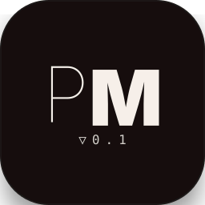
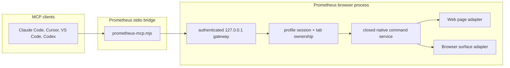

<div align="center">



<br />

<picture>
  <source media="(prefers-color-scheme: dark)" srcset="assets/prometheus-wordmark.svg" />
  
</picture>

**The agent native desktop browser. Full control of the whole browser through structure, not screenshots.**

*Pure structural intelligence. Zero vision. Zero guessing.*


[](https://github.com/fullselfbrowsing/Prometheus/stargazers)
[](https://github.com/fullselfbrowsing/Prometheus/network/members)
[](https://github.com/fullselfbrowsing/Prometheus/issues)
[](https://github.com/fullselfbrowsing/Prometheus/commits/main)

[Why I Built This](#why-i-built-this) · [Overview](#overview) · [Why DOM First](#why-dom-first) · [The Whole Browser](#the-whole-browser-not-just-the-page) · [Architecture](#architecture) · [Features](#features) · [Native Control Surface](#native-control-surface) · [MCP Bridge](#mcp-bridge) · [Quick Start](#quick-start) · [Repository Layout](#repository-layout) · [License](#license-and-attribution)

</div>

---

## Why I Built This

While I have been developing FSB, there were a lot of issues with Chrome's policies and inability to access non web pages and JavaScript execution. At a point I was like, fuck it. I'm gonna do it myself, I'm gonna solve everything and create a fucking browser.

And that's what this is.

---

## Overview

Prometheus is a Chromium-based agent-native browser built by Full Self Browsing. It brings FSB's DOM-first automation into the browser itself, so AI agents and the humans supervising them can inspect, script, click, type, navigate, configure, and recover across the whole browser through first class native structure instead of screenshots, brittle extension injection, or human only UI. The v1.0 foundation was proven on a Falkon/QtWebEngine bootstrap; Falkon is now a preserved reference, not the production base.

Where a Chrome extension can only reach the page, Prometheus owns the browser. Agents drive normal web pages and the surfaces an extension can never touch: settings, tabs, downloads, history, and internal pages. Every action runs through a typed native command router with tab ownership, permission boundaries, change reports, and an audit log.

> **Status:** v2.0 Chromium migration is active. Phases 11–20 are complete with automated evidence: the Chromium baseline, product identity, design assets, browser shell, Prometheus WebUI, native agent and page services, external MCP bridge, and live FSB runtime/provider/vault/memory/log/control-panel stack. Phase 21 next owns supervision and pairing. The v1.0 Falkon/QtWebEngine bootstrap is preserved only as a reference at `.context/falkon-preservation/`.

### What it does

* Drives the live DOM through a native command router: read structure, run permissioned page scripts, click, type, scroll, and verify what changed.
* Controls stable tabs, windows, navigation, Prometheus internal surfaces, and normal-page content through browser-owned authority.
* Exposes a dependency-free stdio MCP bridge so Claude Code, Cursor, VS Code, Codex, and other external MCP clients can drive the browser.
* Enforces browser-issued sessions and multi-agent tab ownership with typed recovery errors.
* Provides live Prometheus side-panel and control-panel workflows for tasks, providers and models, vault metadata, memory and site guides, logs, diagnostics, and enforced FSB settings.
* Keeps supervision, remote pairing, and extension policy as explicit later work in Phases 21 and 22 instead of claiming unavailable behavior.

## Why DOM First

Vision first agents read the page as pixels. Prometheus reads the page as structure, then verifies the result before it moves on.

| Metric | Vision based agents | Prometheus |
|--------|---------------------|------------|
| Page understanding | Screenshots | DOM, selectors, ARIA, forms, structure |
| Browser surfaces | The visible page only | Pages plus settings, tabs, downloads, history, and internal pages |
| Typical per step latency | 1 to 3 seconds | 50 to 200 ms |
| Auditability | Opaque frames | Typed tools, change reports, and a JSONL audit log |
| Cost profile | Image heavy | Text and structure heavy |

The browser stays the source of truth. The model receives structured page context, makes a tool decision, and the browser verifies what changed before the next step.

---

## The Whole Browser, Not Just the Page

A content script lives inside one web page. That is the wrong boundary for an agent that needs to configure providers, manage tabs, read history, or recover a stuck session.

Prometheus puts the control layer inside the browser process, so an agent can reach surfaces a page script never could:

* **Browser owned pages** through `open_internal_surface`, including settings and internal views.
* **Tabs and windows** through native tab and window APIs rather than page level guesses.
* **Direct page scripts** through `execute_js`, with DOM snapshots for read back and verification.
* **Prometheus-owned internal surfaces** through closed native routes, with the live FSB runtime in the browser process and supervision reserved for Phase 21.

---

## Architecture

Prometheus is a layered control spine. An external MCP host launches a small
Prometheus-owned stdio bridge. The bridge discovers the running browser's
owner-only endpoint descriptor, obtains a browser-issued session, and forwards
closed native calls over an authenticated ephemeral IPv4-loopback connection.



Every native command validates the route and schema, pins the regular profile,
enforces session and tab ownership, selects a surface adapter, waits for
observable state when required, verifies mutations, and returns a bounded typed
result. Six closed `/v1/` endpoints cover session create/resume/touch/close,
command dispatch, and health. Every endpoint—including health—requires the
process-fresh bearer published only in the mode-0600 descriptor.

The gateway never accepts a wildcard interface, caller-selected profile,
caller-supplied authority, arbitrary route, or credential on the command line.

---

## Features

| Area | Status | What it does |
|------|--------|--------------|
| Native command service | Ready | Validates closed routes, enforces browser-issued sessions and ownership, returns typed errors/change reports, and writes metadata-only audit records. |
| Page adapter | Ready | Reads bounded text, attributes, DOM/page snapshots, exact same-origin frames, and executes permissioned scripts and verified actions. |
| Multi-agent ownership | Ready | Caps active sessions, pins profiles, preserves stable tab identity, releases ownership on close/expiry, and returns typed recovery errors. |
| MCP bridge | Ready | Dependency-free Node 20 stdio adapter exposing the exact 90-name compatibility inventory to external MCP hosts. |
| Prometheus WebUI | Ready | Side panel, nine-section control panel, new-tab Ask FSB handoff, live tasks, provider/model state, memory/site guides, vault metadata, logs, diagnostics, and effective settings are browser-owned. |
| Runtime, providers, vault, memory, logs | Ready | One regular-profile native state machine executes bounded provider/tool loops, persists sanitized task/accounting state, keeps secrets native, and exposes closed MCP-compatible routes. |
| Supervision and pairing | Phase 21 | Compatibility names remain discoverable but do not claim a working remote-control path. |
| Extension policy and health | Phase 22 | Diagnostic state remains `not_ready` until the extension authority boundary is implemented. |
| Compact chrome and tab management | Ready | Chromium-native compact/separate layouts, tab groups/search, switching, restore, suspend, duplicate, detach, and reorder. |
| Offline icons and themes | Ready | Bundled Font Awesome Free subset, Prometheus assets, typography, and warm dark/light tokens without network dependencies. |

---

## Native Control Surface

The bridge exposes the exact 90-name union of the frozen Prometheus v1 and
current FSB compatibility catalogs. Discoverability is not a readiness claim:
every name has exactly one explicit disposition.

| Disposition | Count | Behavior |
|-------------|------:|----------|
| Native | 49 | Calls a closed Chromium-native route. |
| Alias | 12 | Normalizes to a closed native route. |
| Typed stub | 22 | Returns explicit unsupported or not-yet-safe guidance. |
| Later phase | 5 | Returns `NOT_READY` with its Phase 21 owner. |
| Removed | 2 | Returns `TOOL_REMOVED` with replacement metadata. |

The verified Phase 20 catalog is exactly 49 native, 12 alias, 22 typed stub, five Phase 21, and two removed names.

The ready native surface is:

| Group | Native names |
|-------|--------------|
| Tabs and navigation | `list_tabs`, `open_tab`, `navigate`, `reload`, `go_back`, `go_forward`, `close_tab` |
| Reading and snapshots | `read_page`, `get_text`, `get_attribute`, `get_dom_snapshot`, `get_page_snapshot` |
| Page actions | `execute_js`, `click`, `type_text`, `press_key`, `scroll`, `hover`, `select_option`, `clear` |
| Runtime and task state | `run_task`, `stop_task`, `get_task_status`, `list_tasks`, `get_session_detail`, `list_sessions`, `action_history`, `get_logs`, `runtime_diagnostics` |
| Providers and models | `get_provider_config`, `list_providers`, `discover_models`, `set_provider_config` (local-control authority only) |
| Memory and guides | `save_memory`, `list_memory`, `search_memory`, `get_memory_stats`, `save_site_guide`, `list_site_guides`, `get_site_guide` |
| Vault metadata and confirmed use | `create_vault_entry`, `list_vault_entries`, `list_credentials`, `fill_credential`, `list_payment_methods`, `use_payment_method`, `vault_autofill` |
| Browser surfaces and health | `open_internal_surface`, `diagnostics` |

The twelve ready aliases are `new_tab`, `switch_tab`, `refresh`, `back`,
`type`, `press_enter`, `select`, `clear_input`, `submit_task`, `cancel_task`,
`task_status`, and `list_runtime_logs`. Unsupported coordinate,
drag, sheet, file-drop, and similar names remain discoverable but cannot fall
through to an arbitrary browser route or return empty success.

### Multi agent safety

Several agents can share one browser. Mutating tools require tab ownership, and the router returns typed errors so a client can recover instead of guessing.

| Error | Meaning |
|-------|---------|
| `TAB_NOT_OWNED` | A mutating tool targeted a tab owned by another browser-issued session. |
| `AGENT_CAP_REACHED` | The active session cap was reached. |
| `STALE_TARGET` | A tab, document, frame, or element handle is no longer current. |
| `FRAME_RESTRICTED` | The requested document is outside the exact allowed frame boundary. |
| `PERMISSION_DENIED` | The route requires an explicit browser-owned permission. |
| `UNSUPPORTED_ROUTE` / `CAPABILITY_NOT_READY` | A typed stub has no safe native route yet. |
| `NOT_READY` | A discoverable supervision tool belongs to Phase 21. |
| `TOOL_REMOVED` | A legacy call has per-action replacement metadata. |

Optional `client`, `visual_reason`, and `is_final` presentation metadata travels
independently with compatible actions. These fields never grant identity,
authentication, profile selection, or tab ownership.

---

## MCP Bridge

Phase 19 reimplemented the bridge as a dependency-free Node 20 stdio adapter.
It does not import or execute the archived Falkon implementation. Start the
built Prometheus browser first, then configure an external MCP host to launch:

```sh
node /absolute/path/to/Prometheus/tools/prometheus-mcp/bin/prometheus-mcp.mjs
```

A generic host configuration has this shape:

```json
{
  "mcpServers": {
    "prometheus": {
      "command": "node",
      "args": [
        "/absolute/path/to/Prometheus/tools/prometheus-mcp/bin/prometheus-mcp.mjs"
      ]
    }
  }
}
```

Claude Code, Cursor, Codex, VS Code, and similar products are external MCP
hosts; use the host's own MCP settings UI or configuration format around the
same command. Prometheus never bundles or launches a third-party agent CLI or
runtime. It has no embedded terminal, alternate-agent engine selector,
prompt provisioner, or `CLAUDE.md` provisioning path.

Normal bridge processes create a new browser-issued session. The
`PROMETHEUS_MCP_RESUME_SESSION_ID` environment variable is an advanced
operator/test seam for an already-known opaque id inside the ten-second grace
window. Session ids are intentionally absent from MCP results and logs, so this
is not an automatic user-facing handoff. Abruptly abandoned ownership is
released when the browser expires the session; graceful bridge exit closes it
immediately.

---

## Quick Start

The active workspace is in v2.0 migration mode. Use the Chromium handoff and preservation dossier instead of rebuilding the archived Falkon bootstrap from the root checkout:

- Chromium checkout/build baseline: `.planning/chromium/CHROMIUM-CHECKOUT.md`
- Falkon v1 preserved reference, migration map, visual ledger, and freeze rules: `.planning/preservation/FALKON-TO-CHROMIUM-PRESERVATION.md`
- Preservation verifier: `bash .planning/preservation/verify-preservation.sh`

The Chromium handoff records the active checkout, build arguments, app bundle,
and launch procedure. The Falkon v1 bundle can be restored for reference from
`.context/falkon-preservation/`, but it must not be recreated as a long-lived
production workspace or used as active v2 source.

Provider configuration and vault secret entry remain local browser operations.
External MCP clients can read sanitized provider/vault metadata and request
confirmed use, but they cannot set provider secrets, receive vault values, or
weaken native ownership and per-use confirmation policy.

---

## Supervision

Supervision and remote pairing remain a Phase 21 product contract. The intended
model uses identity-bound structured snapshots and hash-addressed diffs rather
than a bundled third-party agent runtime or indiscriminate video stream.

The five supervision compatibility names are discoverable today but return
truthful Phase 21 `NOT_READY` results. No pairing, remote-control, or supervision
read path is claimed ready by Phase 20.

---

## Repository Layout

| Path | What lives here |
|------|-----------------|
| `.context/falkon-preservation/` | Recoverable v1 Falkon/Prometheus reference bundle and 81-patch source-change series. |
| `.planning/preservation/` | Canonical migration dossier, deferred visual ledger, freeze checklist, and preservation verifier. |
| `.planning/design/` | Product-owned Prometheus/FSB design references, tokens, layouts, and brand assets. |
| `.planning/chromium/` | Chromium checkout/build handoff, baseline evidence, and launch-verification notes. |
| `.context/chromium/src` | Local upstream Chromium source checkout for v2 implementation work; excluded from root commits. |
| `assets/` | Root Prometheus/FSB image assets used by docs and future Chromium packaging. |
| `.planning/` | Product planning, requirements, roadmap, phase records, and preserved v1 decisions. |

---

## License and Attribution

The preserved v1 Falkon/Prometheus reference is GPLv3-or-later and remains recoverable under `.context/falkon-preservation/` with its inherited Falkon, KDE, Qt, Font Awesome, Poppins, Space Mono, and Prometheus/FSB attribution context. That preserved source is reference material, not the v2 production base.

The Chromium migration has mixed Chromium and third-party license obligations. Phase 13 and Phase 24 own the Chromium-era legal/about surfaces, package notices, source guidance, and attribution checks. Do not copy GPL Falkon implementation code into Chromium without explicit license review.

Prometheus is supervised, auditable automation software. It is intentionally not a stealth browser, a scraper farm, or an unsupervised account operator.

<div align="center">

**Prometheus** · Powered by FSB

</div>
